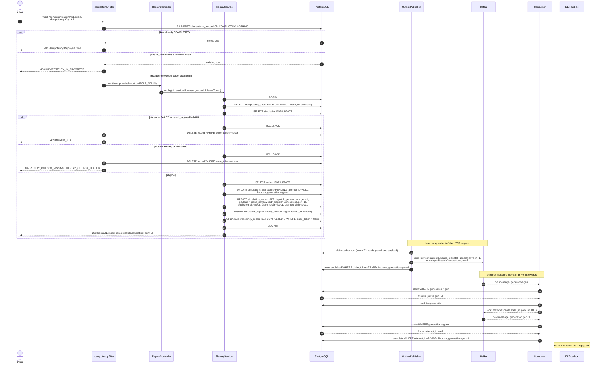

# M4 — Idempotent Retry Recovery: Design

**Status:** Design only (rev 2, closure). No production code, migration, configuration, test, commit or push in this change. All OPEN items are resolved in §5.8; only technical assumptions remain.
**Baseline:** `master` @ `86dc927` (`feat: implement durable DLT publication`), with pre-existing uncommitted local files unrelated to this design (`M1_ACCEPTANCE_SUMMARY.md`, `docs/plans/M1_REMEDIATION_PLAN.md`, untracked `M1_M2_DISCREPANCY_INVESTIGATION.md`, `compile_output.txt`).
**Date:** 2026-11-07
**Scope:** Make request idempotency durable (PostgreSQL authoritative, Redis optional cache) and add an operator-initiated, in-place replay of `FAILED` simulations that reuses the original simulation identity and outbox row, while making stale Kafka deliveries harmless through a monotonic **dispatch generation**.
**Out of scope:** M5/M6 work, result replacement for `COMPLETED` simulations, market-data refresh, automatic replay, changing the stochastic model, DLT retention policy.

**Related documents:** `docs/plans/M1_REMEDIATION_PLAN.md`, `docs/plans/M2_RECONCILIATION_SWEEPER_DESIGN.md`, `docs/plans/M3_DURABLE_DLT_DESIGN.md`, `docs/decisions/0012-transactional-outbox.md`.

---

## Revision log

| Rev | Change |
|---|---|
| 1 | Durable idempotency record, in-place replay, outbox reset, audit table. Fenced only by attempt identity. |
| 2 | Adds a **dispatch generation** fence that is independent of attempt fencing. Separates replay **audit** from replay **idempotency** and scopes the latter. Reassesses U1–U10. Adds the consistency review, generation state model, revised sequence, schema, transition table, failure matrix, M3 compatibility and acceptance criteria. |
| 2.1 | Closure: resolves OPEN-1 – OPEN-8; adds the idempotency lease concurrency proof (§2.9), generation header and poison-message rules (§1.9), the staged V23 migration and rolling deployment (§5.10), and acceptance criteria AC-23 – AC-40. |

### What changed and why (short form)

1. Rev 1 assumed that `attempt_id` fencing was enough to neutralise a stale Kafka message. It is not: `attempt_id` is minted by the consumer at claim time, so a stale message receives a **fresh, valid** attempt id and passes every attempt fence. A second fence carried **by the message** is required. That fence is `dispatch_generation`.
2. Rev 1 stored the idempotency key on the replay audit row. That conflates history with deduplication and cannot represent an in-flight or failed attempt. Rev 2 keeps them separate.
3. Rev 1 left the replaying admin's own retries unprotected. Rev 2 scopes idempotency to the replay and defines exactly what happens for five concrete retry races.

---

## Decision register

All decisions below are **proposed**. None is approved. No code may be written until this document is reviewed and accepted.

| ID | Decision | Section |
|---|---|---|
| **D1** | Add `dispatch_generation INTEGER NOT NULL DEFAULT 1` to `simulations` and `simulation_outbox`. Incremented only by replay; never by claim, release, failure or reconciliation. | §1.4 |
| **D2** | Carry the generation in the event envelope (`dispatchGeneration`, nullable) **and** in the Kafka header `dispatch-generation`. The database column is authoritative at claim time; header and envelope are advisory; disagreement is treated as corruption. | §1.5 |
| **D3** | Replay rewrites only the payload metadata key with `jsonb_set(payload, '{dispatchGeneration}', to_jsonb(:n), true)`. The payload is never deserialised and re-serialised; `marketDataSnapshot` and every input are untouched. | §1.6 |
| **D4** | The consumer claim is generation-fenced. A stale message is acknowledged, counted, and dropped — it is never parked, never retried, never written to the DLT, and never mutates state. | §1.7 |
| **D5** | Failure and DLT writes are generation-fenced. A DLT row is still appended (immutable history) for a stale message that failed deserialisation, but simulation state is not touched. | §1.8 |
| **D6** | Replay is allowed only from `FAILED`, only when the outbox row exists, and only when no live publisher lease exists. Generation bump, status reset, outbox re-arm and audit insert happen in one transaction. | §5.2 |
| **D7** | Idempotency scope is `(user_id, scope_type, scope_id, idempotency_key)` with `SIMULATION_REPLAY` + simulation id for replay and `SIMULATION_RUN` + portfolio id for creation. A sentinel UUID covers unscoped endpoints. | §2.4 |
| **D8** | The same key never triggers a second replay, even if the replay's attempt later fails. A further replay requires a new key. | §2.3 |
| **D9** | `simulation_replay` is append-only audit. It is never used to detect duplicates; `idempotency_record` is the deduplication authority. | §2.5 |
| **D10** | Idempotency completion is written **inside** the business transaction, fenced on the request lease token. A failed transaction compensates by deleting its own `IN_PROGRESS` row. | §2.6 |
| **D11** | Only 2xx responses complete a record. A non-2xx outcome deletes the record so the key remains retryable. | §2.6 |
| **D12** | Replay audit insert, generation bump, outbox reset and idempotency completion are atomic (single transaction, no `REQUIRES_NEW`). | §2.7 |
| **D13** | Request lease default 30 s, ceiling 10 min, configurable; takeover after expiry is fenced on `lease_token`. | §3 (U9) |
| **D14** | 72 h retention applies to request scopes; `SIMULATION_REPLAY` records are retained with the simulation and are exempt from TTL GC. | §3 (U3) |
| **D15** | Response bodies are stored up to 16 KiB. Larger bodies are not stored; the two opt-in endpoints reconstruct the response from the simulation row. | §3 (U5) |
| **D16** | `simulations.idempotency_record_id` and `simulation_replay.idempotency_record_id` are unique back-references so a crash between commit and completion is recoverable without duplication. | §2.6 |
| **D17** | Reconciliation resets must rotate `claim_token`/`claimed_until` and must never write `payload` or `dispatch_generation`. | §4.7 |
| **D18** | Replay requires `ROLE_ADMIN` via `@PreAuthorize`; method security is net-new in this codebase. | §3 (U4) |
| **D19** | Replay authorisation is global `ROLE_ADMIN` for M4, enforced by explicit method-level checks; portfolio-scoped authorisation is deferred to a later milestone. | §3 (U4), §5.8 |
| **D20** | No force replay of stale `PROCESSING` simulations. Recovery from a hung attempt uses the existing reconciliation mechanism. | §2.3 (S4), §5.8 |
| **D21** | No attempt heartbeat in M4. Duplicate same-generation deliveries are handled by the existing claim and lease mechanisms; execution-duration assumptions and residual risk are documented. | §4.10, §5.8 |
| **D22** | Replay `reason` is required, non-blank, bounded to 500 characters, and persisted on the audit row. | §5.3, §5.8 |
| **D23** | Replay audit rows survive simulation soft deletion; the audit FK uses `ON DELETE RESTRICT` and nothing cascades from the audit table. | §5.3, §5.8 |
| **D24** | Response bodies are stored up to 16 KiB; oversized responses are reconstructed deterministically from the simulation row. | §3 (U5), §5.8 |
| **D25** | API and worker database grants remain least-privilege and distinct; the exact column-level permissions are enumerated in §5.3 and §5.10. | §5.3, §5.10 |
| **D26** | V23 is applied in stages: additive columns/tables first, then concurrent index build, then constraint attachment, then validation and narrow grants. Existing rows are logically backfilled to generation 1 by the non-volatile default, with an explicit batched backfill only if PostgreSQL is older than 11. | §5.3, §5.10 |
| **D27** | The idempotency record row is locked (`SELECT ... FOR UPDATE`) and its lease token validated at the start of the business transaction, before any side effect; the lock is held until commit or rollback. | §2.6, §2.9 |
| **D28** | Generation values are resolved by an explicit policy: strict parse, legacy default only under a named compatibility flag, malformed fails closed, future is visible and never treated as stale. | §1.9 |
| **D29** | Replay stays disabled until every active consumer enforces generation fencing; enabling it requires two independent flags plus a fleet verification. | §5.10 |

---

## 1. Stale Kafka delivery after replay

### 1.1 The mechanism, stated precisely

Kafka ordering is per partition. The producer keys simulation events by `simulationId`, so two messages for one simulation normally share a partition and arrive in publish order. That does **not** make the delivery safe, for three independent reasons:

1. **A stalled publisher can publish out of order.** `OutboxPublisher` leases a batch, commits the lease, then performs a blocking send outside the transaction. If a publisher stalls after leasing, its lease expires, a later publisher re-leases the row and sends the new generation, and then the stalled publisher resumes and sends the old payload. Per-partition ordering only orders *the sends that happen*; it cannot order a send that was delayed across a replay.
2. **The consumer can be behind.** A message published before the replay can sit in the partition while the replay commits and a new message is published. The old message is then delivered after the replay transaction, which is exactly the case this section analyses.
3. **Replays are not Kafka operations.** A replay resets the database row and re-arms the outbox. Nothing removes the already-published message from the log. Any design that relies on "the old message has already been consumed" is relying on timing, not on a guarantee.

### 1.2 What the current code actually does

Verified against the working tree:

| Fact | Location |
|---|---|
| The requested event carries no generation: `SimulationRequestedEvent` ends at `occurredAt`. | `probity-shared/.../common/domain/event/SimulationRequestedEvent.java` |
| The consumer claims by simulation id only. The claim predicate is `status = 'PENDING' OR (status = 'PROCESSING' AND updated_at < :staleThreshold)`. | `SimulationJpaRepository.claimForProcessing` (lines 64–71) |
| `claimForProcessing` writes a **new** `attempt_id` and a new `updated_at` fence token on every successful claim. | same |
| Completion, release and failure are fenced on that attempt token. | `SimulationJpaRepository.complete` (96–108), `release` (120–129), `markFailedForAttempt` (150–172) |
| The listener parks and seeks on an unclaimable message, then eventually routes it through the recoverer. | `SimulationRequestedEventConsumer` (claim 95–101, unclaimable switch 180–204) |
| The recoverer receives the full `ConsumerRecord`, so a Kafka header is readable even when the value cannot be deserialised. | `SimulationFailedRecordRecoverer.accept` (38–84) |
| The unclaimed-failure path marks the row with the **non-fenced** `markFailedIfPending`. | `SimulationDltEventWriter` → `SimulationRepository` |
| The outbox row is unique per simulation and its payload is the serialised event. | `V20__simulation_outbox.sql` (`UNIQUE(simulation_id)` line 41, payload semantics 63–64) |
| Publication success/failure is fenced on `claim_token`. | `SimulationJpaRepository` (251–285), `OutboxPublisher` (112–166) |

**Consequence.** A message published under dispatch *g* is indistinguishable, at the consumer, from a message published under dispatch *g+1*. Both claim the same row with equal right. The attempt fence only distinguishes *claims*, and the stale message gets a brand-new claim.

### 1.3 Ordering cases, with and without a generation fence

Notation: the row is at generation *g* before replay, *g+1* after. "Old message" = generation *g*; "new message" = *g+1*. Current behaviour is what the code does today.

**Case A — old message arrives first, after the replay commit, before any new attempt starts**

Row is `PENDING`, generation is not modelled (today).

| Step | Without generation | With generation |
|---|---|---|
| Old message claims | Succeeds (`PENDING`) | Fails (`dispatch_generation = g` vs row `g+1`) |
| Work performed | Full simulation on the **pre-replay snapshot** | None |
| New message arrives | Row is `PROCESSING`; parks until staleness, then steals | Claims normally |
| Outcome | Wasted attempt; replay may appear to succeed but produce the old result. If the old attempt fails it marks the row `FAILED` *after* the replay, so the replay silently dies. | Old message acked and counted; new message is the only attempt. |

This is the most damaging case: **the replay's intent can be satisfied by the pre-replay dispatch**, and the observable status is `COMPLETED`, so nobody notices.

**Case B — old message arrives after the new attempt has started**

Row is `PROCESSING` under the *g+1* attempt.

| Step | Without generation | With generation |
|---|---|---|
| Old message claims | 0 rows while fresh (`PROCESSING` not stale) → park/seek | 0 rows, and classification sees `current > message` → ack, drop |
| Old message after staleness | Steals the claim; gets a new attempt id | Never reaches the steal path |
| New attempt finishes | `complete()` matches 0 rows (attempt id changed) → result discarded | Unaffected |
| Old attempt finishes | Writes the result for the old snapshot | Never runs |
| DLT | New attempt's failure recorded as `NOT_OWNER` | None |

Without generation, staleness converts a live replay into a **last-writer-wins race between generations**, and the winner is whichever attempt happens to run last, not the newest dispatch.

**Case C — duplicate new-generation messages**

Publisher retry or broker redelivery produces two *g+1* messages. Generation fencing cannot and should not separate them: they are the same dispatch. Behaviour is unchanged from today — the claim predicate serialises them; the second parks, and after staleness may steal. Because the model is stochastic, a duplicate run is wasted compute and produces a different (but still *g+1*) result. **This is a residual risk that generation fencing does not solve**; it is bounded by `staleThreshold > maximum attempt duration` and by taking the claim before any expensive work.

**Case D — the new-generation attempt fails and releases, then the old message arrives**

`release` returns the row to `PENDING` (worker-retry path), or the failure path writes `FAILED`.

| Row state on old arrival | Without generation | With generation |
|---|---|---|
| `PENDING` (released) | Old message claims and starts a pre-replay attempt that can later complete | Rejected by generation |
| `FAILED` | Not claimable; message parks then goes to the DLT as noise | Rejected and acked before parking |

The dangerous half is the `PENDING` release path: the replay's failure handling quietly hands the row back to the **previous generation**.

**Case E — replay commits while a *g* message is already in flight to the broker**

This collapses into Case A or B depending on arrival time. There is no third behaviour, which is why the fence must be evaluated in the claim predicate and not in application logic after the claim.

### 1.4 Why attempt fencing is not dispatch fencing

`attempt_id` answers: *"is the caller still the owner of this claim?"*
It does not answer: *"which dispatch does this message belong to?"*

The consumer mints `attempt_id` **after** deciding to claim. A stale message that wins the claim receives a valid, current-looking attempt id and therefore passes `complete`, `release` and `markFailedForAttempt` legitimately. Attempt fencing protects against two consumers racing for one claim; it cannot protect a replay from a message that represents an older operator intent. The two fences are orthogonal:

| Fence | Carried by | Protects against | Rotates on |
|---|---|---|---|
| Attempt (`attempt_id`) | Database, written at claim | Two claims of the same dispatch | Every claim |
| Dispatch (`dispatch_generation`) | Message header/envelope **and** database row | A message from an older dispatch | Every replay |

Both are required. Neither substitutes for the other.

### 1.5 Carrying the generation without corrupting the snapshot

Three candidate carriers were evaluated.

| Option | Survives payload re-drive | Usable before deserialisation | Verdict |
|---|---|---|---|
| Kafka header only | No — a manual re-drive or a DLT replay that rebuilds the record can lose it | Yes | Insufficient alone |
| Envelope field only | Yes | No — a deserialisation failure never reaches the field | Insufficient alone |
| **Both** | Yes | Yes | **Chosen (D2)** |

**Envelope change.** `SimulationRequestedEvent` gains one trailing component:

```java
Integer dispatchGeneration   // nullable; null means the field is absent (legacy)
```

It is appended last so existing JSON payloads without the field still deserialise. Add a `withDispatchGeneration(int)` method that returns a new record instance; the publisher must use it rather than a Jackson round-trip. Do **not** add a helper that silently coerces `null` to `1`: resolution goes through `resolveGeneration(...)` (§1.9) so the legacy policy is explicit and can be disabled.

**Header change.** `dispatch-generation` = the decimal integer, ASCII bytes. Always set by the publisher, including on redelivery.

**Authority order at the consumer:**
1. Database `simulations.dispatch_generation` — authoritative for the claim decision.
2. Header, if present — used when the value cannot be deserialised (recoverer path).
3. Envelope field — used when the header is absent.
4. Absent in both — the legacy default `1` is permitted **only** while `probity.dispatch.legacy-generation-default=true`; otherwise the message is malformed and fails closed.

Resolution, validation, the legacy policy, and the full case table are in §1.9.

If the header and the envelope are both present and disagree, the message is **corrupt**: ack it, increment `simulation.dispatch.corrupt`, emit an alert, append a DLT row recording both values, and do not touch simulation state. The consumer never "picks the larger" — guessing is how a stale message becomes authoritative.

**Payload metadata safety (D3).** The outbox payload is the original market-data snapshot plus inputs. It must not be regenerated on replay: regeneration would re-read market data and change the inputs the operator asked to retry. Replay performs a surgical JSONB update:

```sql
UPDATE simulation_outbox
   SET dispatch_generation = :newGeneration,
       payload = jsonb_set(payload, '{dispatchGeneration}', to_jsonb(:newGeneration), true)
 WHERE simulation_id = :simulationId;
```

`jsonb_set` with `create_missing = true` adds the key if absent and replaces it if present. No other key is read, written, reordered or re-typed. `marketDataSnapshot`, `numberOfSimulations`, `confidenceLevel`, `assumedReturnPct`, `assumedVolatilityPct` and `occurredAt` are untouched; numeric JSONB values keep their numeric type. A `NOT VALID` check constraint documents the invariant for rows written after the migration:

```sql
ALTER TABLE simulation_outbox
  ADD CONSTRAINT ck_outbox_payload_generation
  CHECK (payload->>'dispatchGeneration' IS NULL
         OR (payload->>'dispatchGeneration')::int = dispatch_generation) NOT VALID;
```

Because the constraint is checked per statement, the two assignments above must stay in **one** `UPDATE` (they do). Legacy rows have no key, so the constraint passes immediately; V23_5 validates it before replay is enabled (§5.10).

### 1.6 SQL-level fencing predicates and transaction boundaries

**Claim (worker, one statement, no read-then-write):**

```sql
UPDATE simulations
   SET status = 'PROCESSING',
       attempt_id = :attemptId,
       updated_at = :now
 WHERE id = :id
   AND deleted = FALSE
   AND dispatch_generation = :generation          -- new: dispatch fence
   AND (status = 'PENDING'
        OR (status = 'PROCESSING' AND updated_at < :staleThreshold));
```

The generation is part of the same predicate as the status, so there is no time-of-check/time-of-use window. `RETURNING dispatch_generation` is not needed; a 0-row result is classified by one follow-up read.

**Completion / release / failure (defence in depth):**

```sql
... WHERE id = :id AND attempt_id = :attemptId
      AND dispatch_generation = :generation
```

These cannot race a replay today, because replay requires `FAILED` and `FAILED` implies no live, unfenced attempt. The extra predicate costs nothing and makes the invariant local to the statement, not to a global argument in a design document.

**Replay transaction (one transaction, default isolation, explicit row locks):**

```sql
BEGIN;
SET LOCAL lock_timeout = '2s';

-- T2-open (§2.9): first lock, before any side effect
SELECT state, lease_token FROM idempotency_record
 WHERE id = :recordId FOR UPDATE;
-- abort with 409 IDEMPOTENCY_LOST unless state = 'IN_PROGRESS' and lease_token = :token

SELECT status, dispatch_generation, attempt_id, result_payload
  FROM simulations WHERE id = :id AND deleted = FALSE FOR UPDATE;
-- abort unless status = 'FAILED' and result_payload IS NULL  (D6)

SELECT claim_token, claimed_until, published_at
  FROM simulation_outbox WHERE simulation_id = :id FOR UPDATE;
-- abort if claimed_until >= now()  (live lease)

UPDATE simulations
   SET status = 'PENDING', attempt_id = NULL,
       dispatch_generation = dispatch_generation + 1,
       updated_at = now(), version = version + 1
 WHERE id = :id AND status = 'FAILED';

UPDATE simulation_outbox
   SET dispatch_generation = :newGeneration,
       payload = jsonb_set(payload, '{dispatchGeneration}', to_jsonb(:newGeneration), true),
       published_at = NULL, claim_token = NULL, claimed_until = NULL,
       error_count = 0, last_error = NULL,
       reconcile_count = 0, last_reconciled_at = NULL
 WHERE simulation_id = :id;

INSERT INTO simulation_replay (..., reason, ...) VALUES (...);
UPDATE idempotency_record SET state = 'COMPLETED', ...
 WHERE id = :recordId AND lease_token = :token AND state = 'IN_PROGRESS';
COMMIT;
```

`FOR UPDATE` on `simulations` serialises two operators; `FOR UPDATE` on `simulation_outbox` prevents a concurrent reconciliation reset from interleaving. The outbox reset sets `claim_token = NULL`, which is what makes a stalled publisher's fenced `markPublished ... AND claim_token = :token` match zero rows.

### 1.7 Consumer change (order matters)

```
generation := resolveGeneration(header, envelope)      // §1.9; returns MALFORMED on failure
if generation == MALFORMED: ack; DLT; alert; return    // fail closed, no state change
claimed := claimForProcessing(id, generation, ...)
if claimed == 0:
    live := findLiveStatus(id)
    if live.generation > generation:  ack; metric dispatch.stale; return   // before park/seek
    if live.generation < generation:  alert; metric dispatch.future; ack; return  // visible, never claim
    else:                             existing park/seek/DLT logic
```

`resolveGeneration` never guesses. The stale branch and the future branch are deliberately distinct: stale is normal and silent apart from a counter, future is abnormal and alerts. Neither is parked.

The stale branch **must precede** the existing unclaimable switch. If it is placed after, a stale message is parked and later reaches the DLT as noise (and, on the seek path, can be retried for minutes). A stale message is a successful no-op, not a failure.

A replay can commit between the 0-row update and the follow-up read. That changes only the classification (stale vs state-based), never correctness: the row's generation only increases, so the message can never become claimable by being re-read.

### 1.8 Failure, DLT and why the DLT still records stale messages

The recoverer sees `ConsumerRecord`, so `dispatch-generation` is available even for `DeserializationException`. But `SimulationDltEventWriter.recordUnclaimedFailure` currently calls the **non-fenced** `markFailedIfPending`. Under replay that is a stale-write vector: a deserialisation failure of a *g* message could mark a *g+1* `PENDING` row `FAILED`.

Changes:

1. `simulation_dlt_outbox` gains `dispatch_generation INTEGER DEFAULT 1` (nullable), `dispatch_generation_raw VARCHAR(64)`, and `dispatch_generation_source VARCHAR(20)`, plus an index `(simulation_id, dispatch_generation)`. In PostgreSQL 11+ a non-volatile default is metadata-only; existing DLT rows are not logically modified, and the table remains append-only (no `UPDATE`/`DELETE` grant is added). Nullable is required so a malformed generation can be recorded as `NULL` rather than silently coerced.
2. `markFailedForAttempt` and the unclaimed path both take a generation and add `AND dispatch_generation = :generation`. When the recorded generation is `NULL` (malformed or absent under a disabled legacy policy), the simulation write is skipped entirely.
3. If the generation is stale, the DLT row is **still inserted** (it is a true record of a failed delivery) but the simulation is not touched. Distinguish the two outcomes in the write result: `RECORDED_STALE` vs `RECORDED`; a future generation records `RECORDED_FUTURE` and a malformed one `RECORDED_MALFORMED`.
4. Generation metadata is read from `ConsumerRecord.headers()` **before** any deserialisation attempt. If the header is absent and the value cannot be read, §1.9 applies: the legacy default `1` only when the compatibility flag is enabled, otherwise the message fails closed (DLT row and alert, no simulation mutation). This keeps generation classification independent of event deserialisation, which is the only way a poison message can be classified at all.
5. A malformed generation is never coerced to `1`. The DLT row records the raw value and `NULL` for the parsed generation, and the simulation is not touched.

This preserves the M3 rule that DLT rows are immutable while preventing a DLT write from resurrecting an obsolete dispatch.

### 1.9 Generation resolution: header, envelope, missing, malformed, stale, future, poison

The message-supplied generation is only a **candidate**. `simulations.dispatch_generation` stays authoritative: resolution never queries or overrides the database, it only decides whether the candidate is well formed and what value to compare at claim time.

**Parse rule.** The header is raw ASCII bytes. A valid value matches `^[1-9][0-9]{0,9}$` and is `<= 2147483647`. No trimming, no sign, no locale-sensitive parsing, no `Integer.parseInt` on arbitrary text. The envelope field is `Integer`; `null` means absent and `<= 0` is malformed.

**Resolution order:** header → envelope → legacy policy. When both carriers are present they must be equal; a disagreement is `CORRUPT`, not "trust the header". The header is preferred only because it is available before deserialisation.

| Case | Header | Envelope | Candidate | Action |
|---|---|---|---|---|
| Valid current generation | `"3"` | `3` | 3 | `CLAIM` |
| Valid legacy generation | `"1"` | `1` | 1 | `CLAIM` |
| Header absent, envelope present | absent | `2` | 2 | `CLAIM`; counter `dispatch.generation.header_missing` |
| Both absent, legacy policy enabled | absent | `null` | 1 (`LEGACY_DEFAULT`) | `CLAIM`; counter `dispatch.generation.legacy_default` |
| Both absent, legacy policy disabled | absent | `null` | — | `FAIL_CLOSED` (`ABSENT`) |
| Malformed header or envelope | `"3x"`, `""`, `"0"`, `"-1"`, `"0003"`, 11+ digits | `0` | — | `FAIL_CLOSED` (`MALFORMED`) |
| Carriers disagree | `"2"` | `3` | — | `FAIL_CLOSED` (`CORRUPT`) |
| Stale | `"2"` | `2` | 2 | Claim returns 0; live = 3 → `ACK_STALE` |
| Future | `"4"` | `4` | 4 | Claim returns 0; live = 3 → `ACK_FUTURE` |
| Poison, header valid | `"3"` | unreadable | 3 | DLT row at generation 3; no simulation mutation |
| Poison, header absent | absent | unreadable | 1 if legacy policy enabled, else — | DLT row (`LEGACY_DEFAULT` or `ABSENT`); no mutation |
| Poison, header malformed | `"junk"` | unreadable | — | DLT row with `dispatch_generation = NULL` and the raw value; alert |

**Actions.**

- `CLAIM` — pass the candidate to the generation-fenced claim predicate (§1.6).
- `ACK_STALE` — acknowledge, increment `dispatch.stale`, no DLT row, no state change. Stale is normal after a replay.
- `ACK_FUTURE` — acknowledge, increment `dispatch.future`, **alert**, and append a DLT row with `dispatch_generation_source = 'FUTURE'`. A future generation means this database is behind a producer (restored backup, manual edit, split-brain). It is never claimed and never reclassified as stale; the DLT row is the durable evidence.
- `FAIL_CLOSED` / `CORRUPT` — acknowledge **only after** the DLT row commits, increment `dispatch.malformed`, alert, record `dispatch_generation = NULL` plus `dispatch_generation_raw` (first 64 characters, escaped), and leave the simulation untouched. If the DLT write fails, do not acknowledge, so the record is redelivered.
- Poison messages take the same actions; the difference is only that the envelope is unavailable, which is why the header must be read from `ConsumerRecord.headers()` before any deserialisation.

**Legacy policy.**

- Flag: `probity.dispatch.legacy-generation-default` (env `PROBITY_DISPATCH_LEGACY_GENERATION_DEFAULT`), default `false` in code.
- It applies **only** when both carriers are absent. It never rescues a malformed value and never overrides a disagreement. A malformed value is always `FAIL_CLOSED`.
- It is enabled (`true`) for workers during the compatibility window in §5.10, then turned off. Every use increments `dispatch.generation.legacy_default`; the flag may only be turned off after a full message-retention window with zero uses, and any use after that point pages.
- The flag is transitional and must be deleted in the follow-up change that removes generation-1 compatibility; it is not a permanent switch.

**Why the DLT recoverer can classify poison messages.** `SimulationFailedRecordRecoverer.accept(ConsumerRecord, …)` already receives the raw record, so the header is readable even when `DeserializationException` is thrown. The recoverer must not attempt to parse the payload bytes to recover `dispatchGeneration`: the failed deserialisation is precisely the case where payload parsing is untrustworthy. The header is used first, the envelope second (when deserialisation succeeded), and the legacy policy last.

---

## 2. Replay audit vs replay idempotency

### 2.1 Two different guarantees

These are routinely conflated and must not be:

| Guarantee | Question answered | Owner | Lifetime |
|---|---|---|---|
| **Audit** | *Who replayed what, when, why, and what generation did it produce?* | `simulation_replay` | Permanent (append-only) |
| **Idempotency** | *Has this exact logical request already been accepted?* | `idempotency_record` | Request window (replay: permanent) |

An audit row is written **only on success**, **inside** the replay transaction, and its uniqueness is `(simulation_id, replay_number)`. An idempotency record is written **before** the work starts, exists for failures, and its uniqueness is the request key. Using one for the other produces exactly the bugs listed in §2.3.

### 2.2 Why the audit row cannot be the idempotency record

1. **In-flight requests have no audit row.** Two simultaneous requests with the same key would both find nothing and both proceed.
2. **Failed requests leave no audit row.** A retry after a failure is indistinguishable from a first attempt.
3. **A lost HTTP response is invisible.** The audit row exists and is correct, but the client never saw the response, so "does a row exist?" cannot reproduce it without storing the response.
4. **The natural audit key is not the request key.** `(simulation_id, replay_number)` says "this was the third replay"; it says nothing about which admin key requested it. Two different keys legitimately produce two rows.
5. **Append-only audit must not be updated.** Marking "this audit row now also means the request is complete" violates the immutability that makes it trustworthy.

Therefore (D9): `simulation_replay` is history; `idempotency_record` is the deduplication authority. They are linked by `simulation_replay.idempotency_record_id` (unique), which is a back-reference for recovery and traceability, not a dedup key.

### 2.3 The five required cases

Assumptions: `gen` = current `simulations.dispatch_generation`; `replay_number = gen` (the generation being superseded, so the first replay is number 1 and leaves generation 2); records are keyed by D7.

**S1 — same admin retries after a lost response**

1. First request commits: generation 2, audit row `replay_number = 1`, idempotency record `COMPLETED` with status 202 and body — all one transaction (D12).
2. Response is lost in transit.
3. Retry with the same key: T1 finds `COMPLETED`, hash matches, returns the stored response with `Idempotency-Replayed: true`.
4. **No second replay.** Generation stays 2.

If the crash happened *after* the business commit but *before* the idempotency update (which D10/D12 make impossible, but the recovery path exists anyway), T1 finds `IN_PROGRESS` with an expired lease. Before re-executing, it looks up `simulation_replay.idempotency_record_id = :recordId` (unique). If found, it adopts: marks the record `COMPLETED` from the audit row + reconstructed response, emits `idempotency.orphan_adopted`, and returns 202. The back-reference is what makes this deterministic (D16).

**S2 — two simultaneous requests with the same key**

1. Both attempt `INSERT ... ON CONFLICT DO NOTHING` in T1. Exactly one inserts; the other blocks on the row lock and then reads it.
2. Winner proceeds, `IN_PROGRESS`, lease 30 s.
3. Loser sees `IN_PROGRESS` with a live lease → `409 IDEMPOTENCY_IN_PROGRESS` with `Retry-After: 1`. It does **not** wait, does **not** take over, and does **not** execute.
4. Result: one replay, one audit row, one 202, one 409.

**S3 — two simultaneous requests with different keys for the same simulation**

1. Both pass T1 (different rows) and enter the service.
2. `SELECT ... FOR UPDATE` on `simulations` serialises them. Under READ COMMITTED (Spring's default) the blocked statement re-reads the committed row after the lock is released, so the loser sees `PENDING`, not the stale `FAILED` snapshot.
3. Winner: `FAILED → PENDING`, generation `gen+1`, outbox re-armed, audit row `replay_number = gen`, record `COMPLETED`, 202.
4. Loser: `409 INVALID_STATE`. Its idempotency record is **deleted** by the compensation path (D11), so the key is not poisoned and the admin can reuse it later if appropriate.

If the design used REPEATABLE READ, the loser would fail with a serialization error and would need a retry loop. Staying on READ COMMITTED is deliberate; document it so nobody "hardens" the isolation level and reintroduces the stale-snapshot read.

**S4 — replay after processing has started**

Row is `PROCESSING` after the replay was accepted and the new attempt claimed it.

- Replay is rejected with `409 INVALID_STATE`, even if `PROCESSING` is stale.
- Rationale: allowing it would create a second live attempt for the same generation. Attempt fencing would let one win, but the loser's failure path (`markFailedForAttempt`, generated from a `PROCESSING` timeout or DLT) can write `FAILED` *after* the new replay, which is Case B in §1.3. The operator must wait for the row to reach `FAILED` through the normal failure/DLT path.
- This also means a replay can never overlap a live attempt, which is the invariant that lets `complete`/`release` keep their attempt fence without a generation race.

**S5 — repeat after the new attempt failed**

State: generation 2, status `FAILED`, first replay's record `COMPLETED`.

- **Same key:** return the original 202 (with `Idempotency-Replayed: true` and the original `replay_number = 1`). It does **not** replay again. This is the whole point of D8: a key identifies one logical operator action, not "retry until success". The admin must use a new key.
- **New key:** allowed. Generation 2 → 3, `replay_number = 2`, new audit row, new record.
- The distinction is visible in the response body (`replayNumber`, `dispatchGeneration`), so the operator can tell which action they are seeing.

### 2.4 Key scope and unique constraints

```
UNIQUE (user_id, scope_type, scope_id, idempotency_key)
```

| Endpoint | `scope_type` | `scope_id` | Why |
|---|---|---|---|
| `POST /api/v1/simulations` | `SIMULATION_RUN` | `portfolio_id` | An idempotency key is naturally scoped to the portfolio being simulated; a key reused on another portfolio is a different request. |
| `POST /api/v1/admin/simulations/{id}/replay` | `SIMULATION_REPLAY` | `simulation_id` | Prevents a key from one simulation's replay being replayed against another. |
| Any future opted-in POST with no natural scope | endpoint family | `00000000-0000-0000-0000-000000000000` | Sentinel keeps one constraint for all cases. |

`user_id` is in the key because idempotency keys are client-generated and two admins will both eventually use `retry-1`. `scope_type` is in the key so the same string cannot collide across endpoint families. The sentinel is an explicit constant, not `NULL`, because PostgreSQL unique constraints treat `NULL` values as distinct and would silently disable deduplication.

`simulation_replay` deliberately has **no** unique constraint on the key. Its uniques are:

```
UNIQUE (simulation_id, replay_number)
UNIQUE (idempotency_record_id)
```

`replay_number` never repeats for a simulation, so a race that somehow bypassed the row lock fails at commit rather than producing two audit rows for one generation.

### 2.5 `idempotency_record` shape (constraints that matter)

```
state           IN_PROGRESS | COMPLETED        (no FAILED state; failures delete)
lease_token     UUID, NOT NULL while IN_PROGRESS, NULL when COMPLETED
lease_expires_at TIMESTAMPTZ
request_hash    CHAR(64)  -- SHA-256(method + '\n' + path + '\n' + raw body), hex
response_status / response_body / response_truncated / response_location
expires_at      created_at + retention
```

There is intentionally **no** terminal `FAILED` state. A terminal failed row would need a retry policy, an operator override, and a way to distinguish "failed before side effects" from "failed after partial side effects" — the transaction boundary already answers that. Deleting the row is the only state that is unambiguously retryable.

### 2.6 Transaction protocol

**T1 — claim, own transaction, before the controller:**

```sql
INSERT INTO idempotency_record (id, user_id, scope_type, scope_id, idempotency_key,
                                request_method, request_path, request_hash,
                                state, lease_token, lease_expires_at, expires_at)
VALUES (..., 'IN_PROGRESS', :token, now() + :lease, now() + :retention)
ON CONFLICT (user_id, scope_type, scope_id, idempotency_key) DO NOTHING;
```

If 0 rows inserted, `SELECT ... FOR UPDATE` the existing row and apply:

| Existing state | Action |
|---|---|
| `COMPLETED`, hash matches | Return stored response (`Idempotency-Replayed: true`); never invoke the controller |
| `COMPLETED`, hash differs | `422 IDEMPOTENCY_KEY_REUSED` (U2) |
| `IN_PROGRESS`, `lease_expires_at > now()` | `409 IDEMPOTENCY_IN_PROGRESS` + `Retry-After` |
| `IN_PROGRESS`, expired | Conditional takeover under the same row lock (§2.9): `UPDATE ... SET lease_token = :new WHERE id = :id AND lease_token = :old AND state = 'IN_PROGRESS' AND lease_expires_at < now()`; if 0 rows, re-read once |
| Missing (deleted between insert and select) | Retry the insert once |

T1 commits before the controller runs. That is what makes concurrent same-key requests see each other. T1 failure (DB down) → `503 IDEMPOTENCY_UNAVAILABLE`, controller never invoked (fail closed).

**T2 — ownership check and completion, inside the business transaction:**

T2 has two steps, both in the same transaction as every business write, both using `Propagation.MANDATORY`.

```sql
-- T2-open: first statement of the business transaction, before any side effect
SELECT state, lease_token
  FROM idempotency_record
 WHERE id = :id
   FOR UPDATE;

-- application check under the lock: state = 'IN_PROGRESS' AND lease_token = :token
-- mismatch -> abort with 409 IDEMPOTENCY_LOST; nothing has been written yet

-- ... business writes (simulations, simulation_outbox, simulation_replay) ...

-- T2-complete: last statement before COMMIT
UPDATE idempotency_record
   SET state = 'COMPLETED', response_status = :status, response_body = :body,
       response_truncated = :truncated, response_location = :location,
       lease_token = NULL, updated_at = now()
 WHERE id = :id AND lease_token = :token AND state = 'IN_PROGRESS';
```

The `SELECT ... FOR UPDATE` is taken **first**, so the row lock is held from before the first side effect until commit or rollback. Ownership is decided by `lease_token` equality **under that lock**, not by `lease_expires_at`. Expiry is consulted only by a takeover, and a takeover must acquire the same lock (§2.9). **0 rows updated at T2-complete → throw**, which rolls the business transaction back. A lost lease must never silently commit business state without recording completion.

`REQUIRES_NEW`, async hand-off, or any write that commits before T2-complete is forbidden on an opted-in endpoint. That prohibition is what makes the lock proof in §2.9 valid; without it the proof does not hold.

**Compensation — failed request:**

```
try { chain.doFilter(...) }
catch/finally on non-2xx:
    DELETE FROM idempotency_record
     WHERE id = :id AND lease_token = :token AND state = 'IN_PROGRESS'
```

in a `REQUIRES_NEW` transaction (the business one has rolled back). If the delete itself fails (DB gone), the lease expires and takeover handles it. This is the answer to "a failed API transaction must not permanently stick the record": either the delete succeeds, or the lease expires, or the process died before doing anything — all three converge on retryability.

**Crash matrix for the record:**

| Crash point | Record state | Retry outcome |
|---|---|---|
| Before T1 commit | no row | Fresh request |
| After T1, before business commit | `IN_PROGRESS`, live lease | 409 until lease expiry, then takeover |
| During business transaction | rolled back; `IN_PROGRESS` | Takeover after expiry; compensation if the process survived |
| After business commit (includes T2) | `COMPLETED` | Stored response |
| Between business commit and any post-commit cache write | `COMPLETED` | DB wins; cache is irrelevant |

### 2.7 Replay-specific protocol

Replay is the strict case: idempotency completion, generation bump, outbox re-arm and audit insert are one transaction (D12). There is no `REQUIRES_NEW` anywhere in this path, including the DLT writer (the DLT is not touched by replay at all).

Order inside the transaction:

1. **T2-open** (§2.9): `SELECT ... FOR UPDATE` the `idempotency_record`; require `state = 'IN_PROGRESS'` and `lease_token = :token`. This is the first lock and is held to commit.
2. `SELECT ... FOR UPDATE` simulation; require `FAILED`; require `result_payload IS NULL`; compute `newGeneration = dispatch_generation + 1`, `replayNumber = dispatch_generation`.
3. `SELECT ... FOR UPDATE` outbox; require it exists and `claimed_until IS NULL OR claimed_until < now()`.
4. `UPDATE simulations` (status, attempt, generation, version).
5. `UPDATE simulation_outbox` (generation + `jsonb_set` + reset lease/publication).
6. `INSERT simulation_replay` with `idempotency_record_id` and `reason`.
7. `UPDATE idempotency_record ... WHERE lease_token = :token AND state = 'IN_PROGRESS'` (0 rows → throw → full rollback).
8. Commit.

If the replay is rejected at step 1 or 2, the transaction rolls back, the filter deletes the idempotency record, and the caller gets the 4xx. Nothing is stuck, and no audit row claims a replay that never happened.

### 2.8 HTTP semantics summary

| Outcome | Status | Body | Record |
|---|---|---|---|
| First replay accepted | 202 | `{simulationId, status: PENDING, replayNumber, dispatchGeneration}` + `Location` | `COMPLETED` |
| Same key, already accepted | 202 | Stored/reconstructed body + `Idempotency-Replayed: true` | unchanged |
| Same key, different body | 422 | `IDEMPOTENCY_KEY_REUSED` | unchanged |
| Same key, first request in flight | 409 | `IDEMPOTENCY_IN_PROGRESS` | unchanged |
| Different key, simulation not `FAILED` | 409 | `INVALID_STATE` | deleted |
| Different key, outbox missing | 409 | `REPLAY_OUTBOX_MISSING` | deleted |
| Different key, live publisher lease | 409 | `REPLAY_OUTBOX_LEASED` | deleted |
| Not admin | 403 | standard problem detail | no row |
| DB unavailable in T1 | 503 | `IDEMPOTENCY_UNAVAILABLE` | no row |
| Lease lost at T2-open | 409 | `IDEMPOTENCY_LOST` | unchanged; retry reads the winner's outcome |

### 2.9 Idempotency lease concurrency proof

Settings: default lease **30 s**, hard ceiling **10 min**, property `probity.idempotency.lease`, validated at startup to exceed the JDBC statement timeout. All timestamps are database `now()`.

**What the lease is and is not.** `lease_expires_at` is an availability hint. It tells a retry when it may *attempt* a takeover; it is not a lock and it never releases one. The row lock is owned by the database transaction and is released only by COMMIT or ROLLBACK. Ownership is decided by `lease_token` equality checked **under the lock**, never by comparing clocks.

**T1 takeover protocol** (one short transaction):

1. `SELECT state, lease_token, lease_expires_at FROM idempotency_record WHERE id = :id FOR UPDATE;`
2. Missing row → retry the insert once.
3. `COMPLETED` → return the stored response; never invoke the controller.
4. `IN_PROGRESS` and `lease_expires_at >= now()` → `409 IDEMPOTENCY_IN_PROGRESS`.
5. `IN_PROGRESS` and expired → `UPDATE ... SET lease_token = :new, lease_expires_at = now() + :lease WHERE id = :id AND lease_token = :old AND state = 'IN_PROGRESS' AND lease_expires_at < now()`, then commit.
6. The lock is held across steps 1–5, so two takeovers cannot both succeed.

**T2 protocol.** §2.6: acquire the row lock first, perform every business write under it, complete under the same lock, commit. Lock order is fixed: `idempotency_record → simulations → simulation_outbox`.

| # | Scenario | Database behaviour | Result |
|---|---|---|---|
| **L1** | T1 committed, lease expires before T2 starts | Row is `IN_PROGRESS(token A)`, expired. Retry B locks the row, sees the expiry, replaces the token with B, commits. When A finally starts T2 it acquires the lock, re-reads, and sees token B rather than A → abort `409 IDEMPOTENCY_LOST` before any side effect. | A cannot execute; B executes at most once. |
| **L2** | T2 is running when the lease expires | Expiry is a column value, not a lock. A still holds the row lock; nothing changes until A commits or aborts. | A may commit; expiry alone hands execution to nobody. |
| **L3** | A second request tries takeover during T2 | B's `SELECT ... FOR UPDATE` blocks on A's lock. If A commits, B re-reads `COMPLETED` and returns the stored 202, executing nothing. If A rolls back, B re-reads `IN_PROGRESS`/expired and takes over. | Takeover serialises behind T2; no concurrent execution. |
| **L4** | The original transaction commits | Row becomes `COMPLETED`, `lease_token = NULL`. Every later takeover sees `COMPLETED` and returns the stored response. | Exactly one committed business transaction. |
| **L5** | The original transaction rolls back | All business writes are undone and the lock is released. The row is still `IN_PROGRESS`/expired, or was deleted by the compensation path if the process survived. | A retry executes exactly once. |
| **L6** | The process crashes between T1 and T2 | No business transaction exists, so there are no side effects. The row stays `IN_PROGRESS` until expiry; a retry takes over. | Retryable; at most one execution. |
| **L7** | The process crashes after T2-open but before commit | The database aborts the transaction, releases the lock, and discards every write. Row is `IN_PROGRESS`/expired; takeover applies. | Retryable; at most one execution. |
| **L8** | The process crashes after commit, before the response | Row is `COMPLETED`. | Retry returns the stored response; no second execution. |

**Invariant L.** *Lease expiry cannot allow a second business transaction to commit the same idempotent operation while the original transaction can still commit.*

**Proof.** Suppose transactions A and B, holding distinct tokens `tA ≠ tB`, both commit business writes for the same idempotency record. Each must pass T2-open, which is `SELECT ... FOR UPDATE` on that one row, so A and B are serialised on the row: one acquires the lock first and the other cannot proceed until the first commits or rolls back.

- If A acquired first and committed, the row is `COMPLETED` with `lease_token = NULL` when B finally reads it. B's T2-open predicate (`state = 'IN_PROGRESS' AND lease_token = tB`) fails. Contradiction.
- If A acquired first and rolled back, A committed no business writes, so it is not a counter-example; the argument reduces to B alone.
- The same holds with A and B exchanged.

Therefore at most one transaction commits business writes. ∎

Expiry does not appear in the proof by design. It can only cause a *takeover attempt*, and every attempt contends for the same lock and re-checks the token under it. Under READ COMMITTED, `FOR UPDATE` re-evaluates against the latest committed row when the blocking transaction ends, so a post-commit `COMPLETED` is always observed.

**What the proof depends on** (implementation requirements, not observations):

1. Every side effect of an opted-in endpoint is written in the same transaction, after T2-open and before T2-complete.
2. No `REQUIRES_NEW`, no async hand-off of the business write, no second datasource on the path.
3. The completion update is `Propagation.MANDATORY` and throws on 0 rows.
4. The idempotency row is the first lock taken and the lock order never varies.
5. The database is the only clock for `lease_expires_at`.
6. The lease exceeds the statement timeout but may be shorter than a whole transaction; that is safe and merely makes a concurrent retry wait.
7. The application never converts a transaction timeout into a commit; the database must roll back.

The only cost of a lease expiring during T2 is a blocked retry. That is deliberate: it trades brief latency for a proof that does not depend on how long a request usually takes.

---

## 3. Reassessment of U1–U10

| ID | Rev 1 proposal | Verdict | Rationale and change |
|---|---|---|---|
| **U1** | Opt-in for supported POSTs | **Accepted, narrowed** | Exactly two routes opt in: simulation run and simulation replay. Implemented as an **allowlist** (not a denylist) so a new endpoint cannot inherit idempotency by accident. Startup assertion: every allowlisted route resolves to exactly one handler and, if it stores bodies, declares a reconstructor. |
| **U2** | 422 on hash mismatch (flagged) | **Accepted, flagged** | 422 is correct (syntactically valid, semantically unprocessable) and distinguishable from 409 ("state conflict, retry later"). Keep 422 as default; property `probity.idempotency.mismatch-status` allows 409 for clients that only understand 409. Stable code `IDEMPOTENCY_KEY_REUSED`. Flag: OpenAPI must document it and the error must not echo stored request data. |
| **U3** | 72 h retention protecting active ops | **Modified** | 72 h is kept for request scopes, but GC must be `expires_at < now() AND (state <> 'IN_PROGRESS' OR lease_expires_at < now())`, batched, and must never delete a row with a live lease. Retention is measured from `created_at`, so repeated takeover cannot extend a request's life forever. **Replay scope is exempt (D14):** replay keys are retained with the simulation, because deleting one after 72 h would let a reused key trigger a second replay — the one failure mode idempotency is supposed to prevent. |
| **U4** | Global `ROLE_ADMIN` | **Accepted, with net-new wiring** | There is currently no `@EnableMethodSecurity`, `@PreAuthorize` or `hasRole` in the codebase; this is new wiring, not a one-line annotation. Requires authority mapping from the JWT and 401/403 tests. Global admin is accepted because replay is an operational recovery action; it must be enforced by an explicit handler-level check, not by URL patterns alone. **Portfolio-scoped authorisation is deferred (D19, §5.8).** The actor is recorded on the audit row regardless. |
| **U5** | Store bodies with size limit + reconstruct oversized | **Accepted, made precise** | Limit 16 KiB of serialised body. Above it, store `response_status`, `response_location` and `response_truncated = true`, and reconstruct from the simulation row on replay. Both opt-in endpoints have a deterministic reconstructor. An endpoint without a reconstructor and without a sub-limit body may not opt in (startup validation), so a truncated body is never returned as if it were complete. |
| **U6** | Missing outbox → 409 + alert | **Accepted, extended** | 0 rows → `409 REPLAY_OUTBOX_MISSING` + counter + alert. More than 1 is impossible under `UNIQUE(simulation_id)`; if observed, treat as schema corruption → 500 + alert. `payload` missing or not a JSON object → 409 + alert; never create a payload (that would fabricate inputs). |
| **U7** | No hard replay cap; rate limit + monitor | **Accepted, with thresholds** | A hard cap would block legitimate recovery during an incident and would immediately need an override. Instead: per-admin edge rate limit (e.g. 10/min), per-simulation alert above 5 replays/24 h, dashboard for replay→failure ratio, and a metric for stale-message drops. None of these gate the operation. |
| **U8** | No legacy Redis import | **Accepted** | Redis holds no authoritative state and cannot be imported safely: a stale cache entry can outlive a rolled-back transaction. Flush the idempotency namespace at cutover and let old keys expire. Redis is read-through only **after** the DB decision, and writes happen after commit — never before. |
| **U9** | 10-minute configurable lease | **Modified** | Default **30 s**, hard ceiling 10 min, property `probity.idempotency.lease`, validated at startup to exceed the DB statement timeout. Rationale: the lease covers one request that returns 202 in milliseconds; a 10-minute default turns a crashed request into a 10-minute outage for that key. Takeover remains fenced on `lease_token`, so a shorter lease cannot cause double execution. Endpoints that can exceed the lease must not opt in. |
| **U10** | Exclude sync `/run` | **Accepted, strengthened** | The sync path has no durable simulation row and no outbox, so an idempotency record could not be completed atomically with its result and would protect nothing. Exclusion is by allowlist, plus a negative test that asserts **no** `idempotency_record` row is written for `/run`. |

### 3.1 Net effect on rev 1

- U2, U4, U8, U10 are accepted essentially as written.
- U1, U5, U6, U7 are refined but not reversed.
- U3 and U9 change behaviour and need explicit approval because they alter operational characteristics (permanent replay keys; 30 s default lease).

---

## 4. Consistency review

Each item states the invariant, the mechanism that enforces it, the failure mode if the mechanism is removed, and the test that proves it.

### 4.1 Redis loss cannot bypass durable idempotency

**Invariant:** Redis is never on the correctness path.

**Mechanism:** T1 is a PostgreSQL `INSERT ... ON CONFLICT`. The cache is read only *after* the DB has returned the decision, and written only *after* the business transaction commits. A cache hit is always re-validated against the DB hash (or the cache key includes the hash), so a stale cache entry cannot return a response for a different body.

**If removed:** a Redis flush would silently disable idempotency; a stale key would return the wrong response.

**Test:** flush Redis between the first request and the retry; the retry must still return the stored response and must not execute twice. Point Redis at a closed port; requests must still be deduplicated.

### 4.2 Simulation + outbox + idempotency transaction semantics

**Invariant:** An accepted request is exactly one committed state: `simulations` row + `simulation_outbox` row (+ `idempotency_record` completion). No partial combination is observable.

**Mechanism:** One Spring transaction in the API process, one datasource. `runSimulationAsync` is already `@Transactional`; the idempotency participant joins it with `Propagation.MANDATORY`. The outbox insert is in the same method. No `REQUIRES_NEW`, no event listener, no `@Async`.

**If removed:** committing the simulation without the outbox loses the work (the exact failure the transactional outbox exists to prevent); committing the idempotency record without the simulation returns a 202 for a row that does not exist.

**Test:** force a failure after the outbox insert but before completion; assert all three tables are unchanged. Force a failure after completion; assert the same (completion is last).

### 4.3 A failed API transaction cannot permanently stick an idempotency record

**Invariant:** Every `IN_PROGRESS` row is either owned by a live request, deleted by its owner, or past its lease.

**Mechanism:** Three independent exits — compensation delete (fenced on `lease_token`), lease expiry + fenced takeover, and process death (no row was ever committed, or the lease expires). There is no terminal `FAILED` state to get stuck in. The compensation runs in `REQUIRES_NEW` after the business rollback.

**If removed:** a single 500 permanently reserves the key, and the admin cannot retry without inventing a new key — indistinguishable from a broken system.

**Test:** (a) business exception → next request with the same key proceeds; (b) kill the process after T1 → after the lease, the next request takes over; (c) compensation delete fails → takeover still works.

### 4.4 Replay + audit atomicity

**Invariant:** There is no committed replay without an audit row, and no audit row without a committed replay.

**Mechanism:** Steps 3–6 of §2.7 are one transaction. `UNIQUE(simulation_id, replay_number)` is a backstop, and `replay_number = previous generation` makes a duplicate impossible to insert silently. The audit table has no `UPDATE`/`DELETE` grant.

**If removed:** the audit becomes a best-effort log, and a crash produces either an unauditable replay or an audit row for a replay that never happened. Both destroy the table's only value.

**Test:** inject a failure at each step 3–6 and assert `simulations`, `simulation_outbox`, `simulation_replay` and `idempotency_record` are all unchanged. Then commit and assert all four changed together.

### 4.5 DLT rows are never modified or deleted

**Invariant:** `simulation_dlt_outbox` is append-only history.

**Mechanism:** M4 adds one column (`dispatch_generation`) with a non-volatile default, which PostgreSQL 11+ applies as a catalog change without rewriting rows; no `UPDATE`/`DELETE` grant is added for any role. `SimulationDltEventWriter` only inserts. `dlt_published_at` is updated by the M3 publisher under its existing column-scoped grant, which M4 does not widen. Replay never touches the DLT.

**If removed:** "what actually failed" becomes editable, and a replay could erase the evidence that justified it.

**Test:** attempt an `UPDATE`/`DELETE` as the API role → permission denied. Replay a simulation with DLT rows and assert the rows and their `dlt_published_at` values are byte-identical.

### 4.6 `dlt_published_at IS NULL` is not a universal replay gate

**Invariant:** Replay eligibility depends only on the simulation and its outbox row, never on DLT publication state.

**Why it cannot be a gate:**

1. **Not every failure produces a DLT row.** Listener-side failures that never reach the recoverer, and failures handled by the `NOT_OWNER` path, may leave no row. A NULL-based gate would block replay forever for exactly those cases.
2. **A DLT row can belong to an older generation.** After a replay, the previous generation's DLT row is still (correctly) unpublished or published; it says nothing about the current generation.
3. **Publication is asynchronous and can be stuck.** Coupling recovery to a Kafka publish means a broker incident also disables recovery — the opposite of what the DLT is for.
4. **Replay does not mutate DLT rows,** so their publish state is irrelevant to replay correctness.
5. **"Unpublished" is not "not yet recorded."** The durable fact is the inserted row; publication is downstream transport.

**Mechanism:** The gate is `status = 'FAILED'` + outbox row exists + no live lease + `result_payload IS NULL`. DLT state is surfaced in the operator response as diagnostic information only.

**Test:** replay with `dlt_published_at IS NULL`, with it set, and with no DLT row at all; all three must behave identically with respect to eligibility.

### 4.7 Reconciliation cannot publish an obsolete generation

**Invariant:** The generation that is published is always the generation read from the row at claim time.

**Mechanism:**

- The publisher's claim query returns `payload` **and** `dispatch_generation` in the same statement. It stamps both header and envelope from that value; it never reads a generation from the payload to decide anything.
- The sweeper never writes `payload` and never writes `dispatch_generation`. It only resets publication/lease bookkeeping.
- The sweeper and replay both take `FOR UPDATE` on the outbox row, so they serialise.
- The sweeper's reset rotates `claim_token`/`claimed_until` (D17). Without that rotation, a publisher that claimed before the reset can mark the row published after it, silently undoing the reconciliation. This is a pre-existing hole that M4 closes because replay depends on the same fencing.
- After a replay, a subsequent sweep sees `published_at IS NULL` and has nothing to do.

**Residual:** a publisher that claimed before a replay and sends after it can still put an obsolete message on the topic. That is unavoidable at-least-once behaviour; §1 is the answer, not the publisher. The message is fenced at the consumer.

**Test:** pause a publisher between claim and send, replay the simulation, resume the publisher; assert the DB row stays unpublished (old token), a new publish carries the new generation, and the consumer ignores the old message. Concurrent sweep/replay test asserts one wins cleanly.

### 4.8 Outbox claim-token fencing is correct under replay reset

**Invariant:** Only the publisher holding the current token can mark a row published or failed.

**Mechanism:**

- Replay refuses to run while `claimed_until >= now()`, so it never resets a live lease.
- Once the lease has expired, replay sets `claim_token = NULL` and `claimed_until = NULL`.
- A stale publisher's `markOutboxPublished ... WHERE claim_token = :token` matches 0 rows. 0 rows is a legitimate "I lost the claim" outcome, not an error, and it must not be retried.
- The success/failure updates additionally include `AND dispatch_generation = :generation` as defence in depth, so a future path that preserves the token still cannot cross a generation.

**If removed:** a stalled publisher could mark a freshly re-armed row published, and the replay would never be sent.

**Test:** hold an expired-token publisher, replay, then let it run; assert 0 rows updated, `published_at IS NULL`, and `claim_token IS NULL`. Then let a new publisher claim and publish; assert it succeeds with the new generation.

### 4.9 A stale publisher cannot mark a newer dispatch published

**Invariant:** Publication bookkeeping is monotonic with respect to the current claim.

**Mechanism:** The token is minted per claim and is unique; replay clears it; every mark is token-fenced and generation-fenced. A stale mark is a no-op by construction, not by timing. The same predicate applies to the failure path (`markOutboxFailure`), so a stale failure cannot inflate `error_count` on a new dispatch — which would otherwise trigger the backoff/alert logic for a dispatch that never failed.

**Test:** two publishers, old and new, both hold tokens for the same row (achievable by expiring the first lease). New marks success; old marks success afterwards; assert the row still reflects the new claim and `published_at` was not moved backwards or re-cleared.

### 4.10 Residual risks (not fully solved by this design)

| Risk | Why it remains | Mitigation |
|---|---|---|
| Duplicate **same-generation** delivery | Generation fences generations, not duplicates | Claim predicate serialises; `staleThreshold` exceeds the maximum attempt duration; no heartbeat in M4 (D21, §4.11) |
| Obsolete message still reaches the topic | At-least-once publisher | Consumer generation fence (§1.7) |
| Deserialisation failure with no header and no readable payload | The value cannot be parsed | §1.9 policy: legacy default only under the flag, otherwise fail closed; the DLT row records `NULL` and the raw value |
| Long-running attempt exceeding `staleThreshold` | Steal is allowed by design | Metric + alert on steals; §4.11 |
| Idempotency lease expires while the request is still running | The lease is an availability hint, not a lock | Row lock + token check decide ownership (§2.9); a retry may wait, but cannot execute concurrently |
| Clock skew on `claimed_until` / `lease_expires_at` | Timestamps are DB-side (`now()`), so app clocks do not matter | Use DB time everywhere; never `Instant.now()` for leases |
| Operator replays repeatedly | No hard cap (U7) | Rate limit, per-simulation alert, audit trail |

### 4.11 Attempt duration and duplicate same-generation execution (D21)

The generation fence does not deduplicate a **same-generation** delivery. Two copies of generation `g` are serialised by the claim predicate, not eliminated. This section states the assumption that makes the residual risk acceptable, and the trigger for revisiting it.

- The existing mechanism is unchanged: `claimForProcessing` records `attempt_id` and `claimed_until`; a later delivery parks while the attempt is live and may steal only after `staleThreshold`. Complete, fail and release are fenced on `attempt_id`, so only the newest attempt's write wins.
- **Assumption A1:** a simulation attempt is CPU/memory-bound computation with no non-idempotent external side effect (no payment, email, message to a third party, or external write). Under A1, a steal causes wasted compute and a discarded earlier result, not duplicated observable effects.
- **Assumption A2:** p99.9 attempt duration is below `staleThreshold`, with headroom. The threshold must be at least 2× the observed p99.9 at the time the model is deployed, and re-reviewed whenever the model or hardware changes.
- **No heartbeat in M4 (D21).** A heartbeat is added only when production data shows attempts regularly approach the threshold, or when A1 stops holding. Adding one is a separate design because it changes the worker protocol and the meaning of `claimed_until`.
- **Residual risk:** if A2 is violated, two attempts can run concurrently. Only the newest attempt's database write commits, but external effects (if any) could occur twice. M4 accepts this because A1 holds today. A non-zero, sustained steal rate is the alarm that the assumption is failing.

---

## 5. Deliverable

### 5.1 Dispatch-generation state model

**State variables**

| Variable | Location | Range | Written by |
|---|---|---|---|
| `dispatch_generation` | `simulations`, `simulation_outbox` | integer ≥ 1, monotonic | creation (1), replay (+1) only |
| `dispatchGeneration` | event envelope | integer or null (null = absent; resolved by §1.9) | publisher (always stamps), replay (payload rewrite) |
| `dispatch-generation` | Kafka header | ASCII integer | publisher (always) |
| `attempt_id` | `simulations` | UUID or null | claim (new UUID), replay (null) |
| `replay_number` | `simulation_replay` | integer ≥ 1, unique per simulation | replay (`= generation before increment`) |

**Invariants**

| ID | Invariant | Enforcement |
|---|---|---|
| **G1** | The two generation columns are equal in every committed state. | Deferrable composite FK `simulation_outbox(simulation_id, dispatch_generation) → simulations(id, dispatch_generation)`; replay writes both in one statement pair in one transaction |
| **G2** | Generation never decreases and increments by exactly 1 per replay. | Replay `SET dispatch_generation = dispatch_generation + 1` under `FOR UPDATE`; no other writer has the column in its grant |
| **G3** | `status = 'PENDING'` resulting from a replay always has a higher generation than the `FAILED` state it replaced. | Same `UPDATE` that changes status also increments generation |
| **G4** | A claim records the generation it claimed and it equals the row's generation at that instant. | Generation is part of the claim `WHERE`; `attempt_id` and generation are written by the same statement |
| **G5** | A message's generation is the generation of the dispatch that produced it. | Publisher stamps header and envelope from the row, in the claim transaction |
| **G6** | A message is stale iff `message.generation < row.generation`. | Consumer classification query |
| **G7** | `replay_number` is unique per simulation and equals the superseded generation. | `UNIQUE(simulation_id, replay_number)`; computed as `replay_number = dispatch_generation` before the increment |
| **G8** | Replay is impossible while an attempt is live. | Replay requires `FAILED`; `FAILED` is written only after the attempt is over; `PROCESSING` is rejected |

**Generation lifecycle**

```
creation ──► gen 1 ──(attempt fails)──► FAILED(gen 1)
                                          │
                                    replay(key K1)
                                          ▼
                                    PENDING(gen 2), replay_number 1
                                          │
                                    attempt fails
                                          ▼
                                    FAILED(gen 2)
                                          │
                              ┌───────────┴────────────┐
                        same key K1                new key K2
                              │                        │
                    202, no state change        PENDING(gen 3), replay_number 2
```

**Message lifecycle relative to generation**

```
published(g) ──► in flight ──► delivered
                                  │
                    row.generation == g ?
                       │                 │
                      yes                no (row > g)
                       │                 │
                   normal claim      ack + metric
                                        (never park, never DLT, never mutate)
```

### 5.2 Revised replay sequence



Rejection paths are drawn once for `INVALID_STATE`; `OUTBOX_MISSING` and `OUTBOX_LEASED` follow the same rollback + delete + 409 shape.

### 5.3 Revised schema (`V23`, applied in stages)

Confirmed free: migrations end at `V22`. The schema is additive, but it is **not** applied as one blocking script. It is split so that no statement holds a long lock on `simulations`, `simulation_outbox` or `simulation_dlt_outbox` while the application is serving traffic:

| Stage | File | Transactional | Content |
|---|---|---|---|
| **V23_1** | `V23_1__idempotency_schema.sql` | yes | `idempotency_record` table and its indexes; new small-table indexes. Short locks only. |
| **V23_2** | `V23_2__generation_columns.sql` | yes | `dispatch_generation` columns with a non-volatile default; `NOT VALID` checks. Metadata-only `ADD COLUMN` in PG 11+. |
| **V23_3** | `V23_3__generation_indexes.sql` | **no** | `CREATE UNIQUE INDEX CONCURRENTLY` on `simulations (id, dispatch_generation)` and `CREATE INDEX CONCURRENTLY` on `simulation_dlt_outbox (simulation_id, dispatch_generation)`. Requires Flyway `executeInTransaction=false` (see assumption A3). |
| **V23_4** | `V23_4__generation_constraints.sql` | yes | Attach the unique constraint with `ADD CONSTRAINT ... UNIQUE USING INDEX` (no rebuild); add the outbox composite FK and replay FKs as `NOT VALID`; add grant statements. |
| **V23_5** | `V23_5__generation_validation.sql` | yes | `VALIDATE CONSTRAINT` for the outbox check and FK; `ANALYZE`. |

`VALIDATE CONSTRAINT` takes `SHARE UPDATE EXCLUSIVE`, which does not block reads or writes, so it is safe outside a maintenance window. The `ADD COLUMN ... DEFAULT 1` statements are metadata-only in PostgreSQL 11+ and logically backfill every existing row to generation 1 without a rewrite; no `UPDATE` is issued. If the deployment is on PostgreSQL 10 or older, assumption A2 fails and an explicit batched backfill is required.

```sql
-- ===================================================== V23_1: idempotency (transactional)
-- ---------------------------------------------------------------- idempotency
CREATE TABLE idempotency_record (
    id                 UUID PRIMARY KEY,
    user_id            UUID         NOT NULL,
    scope_type         VARCHAR(40)  NOT NULL,
    scope_id           UUID         NOT NULL,
    idempotency_key    VARCHAR(255) NOT NULL,
    request_method     VARCHAR(10)  NOT NULL,
    request_path       TEXT         NOT NULL,
    request_hash       CHAR(64)     NOT NULL,
    state              VARCHAR(20)  NOT NULL,
    lease_token        UUID,
    lease_expires_at   TIMESTAMPTZ,
    response_status    INTEGER,
    response_body      TEXT,
    response_truncated BOOLEAN      NOT NULL DEFAULT FALSE,
    response_location  TEXT,
    created_at         TIMESTAMPTZ  NOT NULL DEFAULT now(),
    updated_at         TIMESTAMPTZ  NOT NULL DEFAULT now(),
    expires_at         TIMESTAMPTZ  NOT NULL,
    CONSTRAINT uq_idempotency_record
        UNIQUE (user_id, scope_type, scope_id, idempotency_key),
    CONSTRAINT ck_idempotency_state
        CHECK (state IN ('IN_PROGRESS', 'COMPLETED')),
    CONSTRAINT ck_idempotency_lease
        CHECK ((state = 'IN_PROGRESS') = (lease_token IS NOT NULL)),
    CONSTRAINT ck_idempotency_completion
        CHECK (state <> 'COMPLETED' OR response_status IS NOT NULL)
);

CREATE INDEX idx_idempotency_record_expiry
    ON idempotency_record (expires_at)
    WHERE state <> 'IN_PROGRESS';

-- ===================================================== V23_2: columns (transactional, metadata-only)
ALTER TABLE simulations
    ADD COLUMN dispatch_generation INTEGER NOT NULL DEFAULT 1,
    ADD COLUMN idempotency_record_id UUID;

ALTER TABLE simulations
    ADD CONSTRAINT ck_simulations_dispatch_generation
        CHECK (dispatch_generation >= 1) NOT VALID,
    ADD CONSTRAINT fk_simulations_idempotency_record
        FOREIGN KEY (idempotency_record_id) REFERENCES idempotency_record (id)
        ON DELETE RESTRICT NOT VALID;

CREATE UNIQUE INDEX uq_simulations_idempotency_record
    ON simulations (idempotency_record_id)
    WHERE idempotency_record_id IS NOT NULL;

ALTER TABLE simulation_outbox
    ADD COLUMN dispatch_generation INTEGER NOT NULL DEFAULT 1;

ALTER TABLE simulation_outbox
    ADD CONSTRAINT ck_outbox_dispatch_generation
        CHECK (dispatch_generation >= 1) NOT VALID;

-- DLT: nullable generation so a malformed header is recorded as NULL, never coerced
ALTER TABLE simulation_dlt_outbox
    ADD COLUMN dispatch_generation        INTEGER DEFAULT 1,
    ADD COLUMN dispatch_generation_raw    VARCHAR(64),
    ADD COLUMN dispatch_generation_source VARCHAR(20);

-- ===================================================== replay audit
CREATE TABLE simulation_replay (
    replay_id              UUID PRIMARY KEY,
    simulation_id          UUID         NOT NULL,
    replay_number          INTEGER      NOT NULL,
    dispatch_generation    INTEGER      NOT NULL,
    previous_status        VARCHAR(20)  NOT NULL,
    idempotency_record_id  UUID         NOT NULL,
    requested_by           UUID         NOT NULL,
    reason                 VARCHAR(500) NOT NULL,
    request_id             VARCHAR(64),
    created_at             TIMESTAMPTZ  NOT NULL DEFAULT now(),
    CONSTRAINT fk_replay_simulation
        FOREIGN KEY (simulation_id) REFERENCES simulations (id)
        ON DELETE RESTRICT,
    CONSTRAINT fk_replay_idempotency
        FOREIGN KEY (idempotency_record_id) REFERENCES idempotency_record (id)
        ON DELETE RESTRICT,
    CONSTRAINT uq_replay_number
        UNIQUE (simulation_id, replay_number),
    CONSTRAINT uq_replay_idempotency
        UNIQUE (idempotency_record_id),
    CONSTRAINT ck_replay_generation
        CHECK (dispatch_generation = replay_number + 1),
    CONSTRAINT ck_replay_reason
        CHECK (btrim(reason) <> '')
);

CREATE INDEX idx_replay_simulation_created
    ON simulation_replay (simulation_id, created_at DESC);

-- ===================================================== V23_3: concurrent indexes (executeInTransaction=false)
CREATE UNIQUE INDEX CONCURRENTLY uq_simulations_id_generation_idx
    ON simulations (id, dispatch_generation);

CREATE INDEX CONCURRENTLY idx_dlt_simulation_generation
    ON simulation_dlt_outbox (simulation_id, dispatch_generation);

-- ===================================================== V23_4: attach constraints (no index rebuild)
ALTER TABLE simulations
    ADD CONSTRAINT uq_simulations_id_generation
        UNIQUE USING INDEX uq_simulations_id_generation_idx;

ALTER TABLE simulation_outbox
    ADD CONSTRAINT fk_outbox_simulation_generation
        FOREIGN KEY (simulation_id, dispatch_generation)
        REFERENCES simulations (id, dispatch_generation)
        DEFERRABLE INITIALLY DEFERRED NOT VALID,
    ADD CONSTRAINT ck_outbox_payload_generation
        CHECK (payload->>'dispatchGeneration' IS NULL
               OR (payload->>'dispatchGeneration')::int = dispatch_generation)
        NOT VALID;

-- ===================================================== V23_5: validation (SHARE UPDATE EXCLUSIVE)
ALTER TABLE simulations       VALIDATE CONSTRAINT ck_simulations_dispatch_generation;
ALTER TABLE simulations       VALIDATE CONSTRAINT fk_simulations_idempotency_record;
ALTER TABLE simulation_outbox VALIDATE CONSTRAINT ck_outbox_dispatch_generation;
ALTER TABLE simulation_outbox VALIDATE CONSTRAINT fk_outbox_simulation_generation;
ALTER TABLE simulation_outbox VALIDATE CONSTRAINT ck_outbox_payload_generation;
ANALYZE simulations;
ANALYZE simulation_outbox;

COMMENT ON COLUMN simulations.dispatch_generation
    IS 'Dispatch intent counter. 1 = original request; +1 per accepted replay. '
       'Carried in every event and checked by the consumer claim.';
COMMENT ON COLUMN simulation_outbox.dispatch_generation
    IS 'Generation of the pending dispatch intent. Must equal simulations.dispatch_generation.';
COMMENT ON COLUMN idempotency_record.state
    IS 'IN_PROGRESS while a request owns the lease; COMPLETED once the business transaction committed. '
       'Failures delete the row; there is deliberately no FAILED state.';
COMMENT ON COLUMN simulation_replay.replay_number
    IS 'Generation that this replay superseded. Unique per simulation. Audit only, never a dedup key.';
COMMENT ON COLUMN simulation_replay.reason
    IS 'Operator-supplied justification. Required, non-blank, at most 500 characters; survives soft deletion.';
COMMENT ON COLUMN simulation_dlt_outbox.dispatch_generation
    IS 'Parsed generation, or NULL when the header was malformed. Never coerced.';
COMMENT ON COLUMN simulation_dlt_outbox.dispatch_generation_raw
    IS 'Raw carrier value as received, truncated to 64 characters.';
COMMENT ON COLUMN simulation_dlt_outbox.dispatch_generation_source
    IS 'HEADER | ENVELOPE | LEGACY_DEFAULT | FUTURE | MALFORMED | ABSENT | CORRUPT.';
```

**Backfill and validation rules.**

- Existing `simulations`, `simulation_outbox` and `simulation_dlt_outbox` rows read as generation `1` because of the `DEFAULT 1`; no `UPDATE` is needed. The default is non-volatile, so PostgreSQL 11+ stores it in the catalog instead of rewriting the table.
- Existing outbox payloads do not contain `dispatchGeneration`, so `ck_outbox_payload_generation` passes on every row. **Precondition:** before V23_4, run `SELECT count(*) FROM simulation_outbox WHERE payload->>'dispatchGeneration' IS NOT NULL AND payload->>'dispatchGeneration' !~ '^[1-9][0-9]{0,9}$';` and quarantine any row it returns. Without that check, `VALIDATE CONSTRAINT` can fail on an invalid cast and block the migration.
- `simulation_replay.reason` is validated by `VARCHAR(500)` plus `ck_replay_reason`; the application also rejects missing, blank and over-length values with `400 REPLAY_REASON_INVALID` before T1 (AC-23).
- No constraint is added to `simulation_dlt_outbox` beyond the columns; the table remains append-only with no `UPDATE`/`DELETE` grant.

**Grants (additive; exact role names must be confirmed against existing migrations):**

| Object | `probity_api` | `probity_worker` |
|---|---|---|
| `idempotency_record` | SELECT, INSERT, UPDATE, DELETE | none |
| `simulation_replay` | SELECT, INSERT | SELECT |
| `simulations` | UPDATE (`status`, `attempt_id`, `dispatch_generation`, `updated_at`, `version`, `idempotency_record_id`) | unchanged |
| `simulation_outbox` | SELECT, INSERT, UPDATE (`dispatch_generation`, `payload`, `published_at`, `claim_token`, `claimed_until`, `error_count`, `last_error`, `reconcile_count`, `last_reconciled_at`) | existing UPDATE retained but **must be column-scoped** to exclude `dispatch_generation` and `payload`; if the current grant is table-wide, narrow it in V23_4 |
| `simulation_dlt_outbox` | no access | existing column-scoped INSERT extended with `dispatch_generation`, `dispatch_generation_raw`, `dispatch_generation_source`; no UPDATE/DELETE |

```sql
GRANT SELECT, INSERT, UPDATE, DELETE ON idempotency_record TO probity_api;
GRANT SELECT, INSERT               ON simulation_replay  TO probity_api;
GRANT SELECT                       ON simulation_replay  TO probity_worker;

GRANT UPDATE (status, attempt_id, dispatch_generation, updated_at, version,
              idempotency_record_id)
    ON simulations TO probity_api;

GRANT UPDATE (dispatch_generation, payload, published_at, claim_token, claimed_until,
              error_count, last_error, reconcile_count, last_reconciled_at)
    ON simulation_outbox TO probity_api;

-- Extend the existing V22 column-scoped INSERT grant; do not grant table-wide INSERT.
GRANT INSERT (dispatch_generation, dispatch_generation_raw, dispatch_generation_source)
    ON simulation_dlt_outbox TO probity_worker;

-- Negative guarantees, asserted by a grant test (AC-40):
--   probity_worker has no INSERT/UPDATE/DELETE on idempotency_record
--   probity_worker has no UPDATE on simulation_outbox.dispatch_generation or .payload
--   probity_worker has no UPDATE/DELETE on simulation_dlt_outbox or simulation_replay
--   probity_api   has no INSERT/UPDATE/DELETE on simulation_dlt_outbox
--   no role has DELETE on simulation_replay
```

The V20 grant (`SELECT, INSERT` on `simulation_outbox` for the API role, lines 95–104) is **insufficient** for replay; the `UPDATE` grant above is a required part of this migration, not an afterthought. The worker's ability to write `dispatch_generation` and `payload` is not required by any worker path: the publisher reads `payload` and writes only the claim/publication columns, and reconciliation is forbidden from writing either column (D17). Removing those column privileges makes the invariant "only replay increments generation" a database guarantee rather than a code convention.

### 5.4 Updated transition table

Rows are `(status, generation, attempt)`; columns are events.

| State | new msg (g = n) | new msg (g < n) | new msg (g > n) | complete(attempt) | fail(attempt) | release(attempt) | replay | reconcile reset |
|---|---|---|---|---|---|---|---|---|
| `PENDING(n, ·)` | → `PROCESSING(n, A)` | ack, no-op | alert + ack | 0 rows (no attempt) | 0 rows | 0 rows | 409 `INVALID_STATE` | re-arm (already unarmed) |
| `PROCESSING(n, A)` | park (fresh) / steal → new attempt (stale) | ack, no-op | alert + ack | → `COMPLETED(n)` | → `FAILED(n, A)` | → `PENDING(n, ·)` | 409 `INVALID_STATE` | reset if lease expired (rotates token) |
| `COMPLETED(n, ·)` | park then DLT (existing behaviour, unchanged) | ack, no-op | alert + ack | 0 rows | 0 rows | 0 rows | 409 `INVALID_STATE` | no-op |
| `FAILED(n, ·)` | park then DLT (existing behaviour, unchanged) | ack, no-op | alert + ack | 0 rows | 0 rows | 0 rows | → `PENDING(n+1)` + outbox re-arm + audit | no-op |

Notes:

- "steal" is allowed only when `updated_at < staleThreshold`; that behaviour is unchanged and is why G4 puts the generation in the claim predicate.
- The `g > n` column is a should-never-happen (restored backup, manual DB edit). It is never treated as "newer, therefore claim": the message is acked, alerted, and recorded in the DLT with source `FUTURE` (§1.9). The DLT row is evidence, not a retry queue entry.
- Replay from `PROCESSING` is rejected even when stale (S4).
- A same-generation message against a terminal state keeps today's park/DLT behaviour. This is noise, not corruption; changing it is out of scope because it would alter M3 DLT semantics.

### 5.5 Updated failure and concurrency matrix

| ID | Scenario | Expected | Invariant | Test |
|---|---|---|---|---|
| **C1** | Old-generation message arrives first after replay commit | Claim 0 rows; classified stale; ack; metric; no state change | G6 | Publish g, replay, deliver g, assert `PENDING` at g+1 and no attempt |
| **C2** | Old-generation message arrives after the new attempt started | Claim 0 rows (generation); ack; the new attempt is unaffected | G4, G6 | Two-consumer test with a paused first attempt |
| **C3** | Duplicate new-generation messages | First claims; second parks, may steal after staleness; no cross-generation effect | G5 | Deliver the same g+1 twice |
| **C4** | New attempt fails and releases, then an old message arrives | Released row is `PENDING` at g+1; the old message is rejected by generation | G1, G6 | Force release, then deliver g |
| **C5** | Replay commits while a g message is in flight | Same as C1 or C2 by arrival time; never a pre-replay write | G6 | Hold the consumer, replay, release |
| **C6** | Header and envelope generations disagree | Ack + alert + DLT row recording both; no simulation mutation | D2 | Craft a record with a mismatched header |
| **C7** | A g message fails deserialisation after a replay | DLT row appended with `dispatch_generation = g`; simulation untouched | D5 | Poison payload + header g |
| **C8** | Same replay key retried after a lost response | Stored 202 + `Idempotency-Replayed: true`; no second replay | D8 | Drop the response, retry |
| **C9** | Two simultaneous same-key replays | One 202, one 409 `IDEMPOTENCY_IN_PROGRESS`; one audit row | D7 | Concurrent requests, barrier-synchronised |
| **C10** | Two simultaneous different-key replays | One 202 at g+1; one 409 `INVALID_STATE`; loser's record deleted | D10, D11 | Concurrent requests, assert generation +1 only |
| **C11** | Replay while `PROCESSING` | 409 `INVALID_STATE`, even when stale | G8 | Claim then replay |
| **C12** | Repeat after the new attempt failed, same key | Original 202 returned; generation unchanged | D8 | Replay → fail → same key |
| **C13** | Repeat after the new attempt failed, new key | 202 at g+2, `replay_number = 2` | G2, G7 | Replay → fail → new key |
| **C14** | Crash after business commit, before the response | Record is already `COMPLETED`; retry returns 202 | D10, D12 | Fault injection after service return |
| **C15** | Business exception mid-transaction | All four tables unchanged; record deleted; same key retryable | D10, D11 | Forced exception in the service |
| **C16** | Redis unavailable | No behavioural change; dedup still enforced | §4.1 | Closed Redis port |
| **C17** | PostgreSQL unavailable in T1 | 503 `IDEMPOTENCY_UNAVAILABLE`; controller never invoked | Fail closed | Broken datasource |
| **C18** | Outbox row missing for a `FAILED` simulation | 409 `REPLAY_OUTBOX_MISSING` + alert; record deleted | U6 | Delete the outbox row in a fixture |
| **C19** | Outbox row under a live publisher lease | 409 `REPLAY_OUTBOX_LEASED`; no reset | D6 | Hold a lease, replay |
| **C20** | Expired lease, stalled publisher resumes after replay | Old mark matches 0 rows; `published_at` stays NULL | §4.8 | Pause between claim and mark |
| **C21** | Replay and reconciliation resets race | Serialised on the outbox row; one wins; generation never written by the sweeper | §4.7 | Concurrent sweeper + replay |
| **C22** | Stale publisher marks success after a new claim | 0 rows; the new claim's state is unchanged | §4.9 | Two tokens for one row |
| **C23** | Attempt to mutate or delete a DLT row | Permission denied; rows are byte-identical after a replay | §4.5 | Grant test |
| **C24** | Application clock skew | Leases and staleness still correct because all comparisons use DB `now()` | §4.10 | Restore-flow test with a skewed JVM clock |
| **C25** | Lease expires before T2 starts, then a retry takes over | Original aborts at T2-open with `409 IDEMPOTENCY_LOST`; retry executes once | §2.9 L1 | Pause the original thread past the lease, start a retry |
| **C26** | Lease expires while T2 runs, then a retry attempts takeover | Retry blocks on the row lock; if T2 commits, the retry returns the stored 202 and executes nothing | §2.9 L2–L3 | Hold T2 open, start a retry, commit |
| **C27** | T2 rolls back after the lease expired | Row lock released; takeover succeeds; retry executes once | §2.9 L5 | Force a business exception after T2-open |
| **C28** | Crash between T1 and T2 | No side effects; after expiry a retry executes once | §2.9 L6 | Kill the process after T1 commits |
| **C29** | Malformed generation header | Ack only after a DLT row with `NULL` generation and the raw value; no claim, no mutation | §1.9, AC-28 | Craft `"3x"`, `"0"`, `"0003"` |
| **C30** | Future generation | Ack + alert + DLT row with source `FUTURE`; never claimed and never counted as stale | §1.9, AC-31 | Set the row to 3, deliver generation 4 |

### 5.6 M3 compatibility

| M3 element | Impact | Action |
|---|---|---|
| `SimulationRequestedEvent` | Additive nullable component | Add `dispatchGeneration` last and `withDispatchGeneration(int)`; existing payloads still deserialise. No silent null-to-1 helper: `resolveGeneration(...)` (§1.9) applies the legacy policy. |
| `SimulationFailedRecordRecoverer.accept(ConsumerRecord, …)` | Already has the record | Read `dispatch-generation` **before** any deserialisation attempt; fall back to the deserialised envelope only when deserialisation succeeded; apply §1.9 (legacy default only under the flag, malformed fails closed). Put the resolved value, source and raw value on `FailureContext`. |
| `SimulationDltEventWriter.recordAttemptFailure` | `REQUIRES_NEW` retained | Pass generation into `markFailedForAttempt`; keep the separate transaction because the listener transaction may be poisoned — **do not** copy this propagation into replay |
| `recordUnclaimedFailure` | Currently non-fenced `markFailedIfPending` | Replace with `markFailedIfPendingAndGeneration(id, generation)`; insert the DLT row regardless, and skip the simulation write when generation is `NULL` |
| `simulation_dlt_outbox` | Append-only | Add nullable `dispatch_generation` (default 1), `dispatch_generation_raw`, `dispatch_generation_source`; add a concurrent index; extend the column-scoped INSERT grant; add no UPDATE/DELETE grant |
| `dlt_published_at` | Unchanged | Explicitly **not** a replay gate (§4.6); exposed as diagnostic data |
| DLT publisher | Unchanged | Publishes rows in insertion order; generation is not used to filter, because DLT history is complete by design |
| `attempt_id` (`V22` comment: "M4 reset must rotate or clear it") | Requirement satisfied | Replay sets `attempt_id = NULL`; the comment can be updated to "cleared by replay" |
| Attempt fencing | Retained | Generation predicates are added alongside, never replace them |
| M2 reconciliation | Shared outbox | Add token rotation on reset (D17); never write `payload` or `dispatch_generation`; serialise with replay via `FOR UPDATE` |
| M1 outbox uniqueness | `UNIQUE(simulation_id)` | Replay updates the existing row only; never inserts |
| JSON contract / schema registry | Additive nullable field | Backwards compatible; verify no `additionalProperties: false` consumer schema rejects it |

### 5.7 Acceptance criteria

| ID | Given / When / Then |
|---|---|
| **AC-1** | Given a simulation at generation 1 with an old message in the topic, when an operator replays it, then the old message is acknowledged without an attempt, a DLT row, or a state change. |
| **AC-2** | Given a replay has committed, when the old-generation message is delivered at any later time, then `simulations.status`, `attempt_id` and `result_payload` are unchanged. |
| **AC-3** | Given two simultaneous different-key replays, then exactly one generation increment is committed and exactly one audit row exists. |
| **AC-4** | Given a replayed simulation whose new attempt fails, then the row is `FAILED` at the new generation and the old generation's messages remain no-ops. |
| **AC-5** | Given a replay, then `simulation_outbox.payload -> 'marketDataSnapshot'` is byte-for-byte equal before and after (JSONB equality), and only `dispatchGeneration` differs. |
| **AC-6** | Given a replay, then `simulations.dispatch_generation = simulation_outbox.dispatch_generation = previous + 1`. |
| **AC-7** | Given a replay, then the publisher's record carries header `dispatch-generation` and envelope `dispatchGeneration` equal to the row's generation. |
| **AC-8** | Given a header/envelope mismatch, then the consumer acks, alerts, and writes a DLT row with both values; no simulation mutation occurs. |
| **AC-9** | Given a `FAILED` simulation with no outbox row, then replay returns 409 `REPLAY_OUTBOX_MISSING` and the idempotency record is deleted. |
| **AC-10** | Given a live publisher lease, then replay returns 409 `REPLAY_OUTBOX_LEASED` and the outbox row is unchanged. |
| **AC-11** | Given an expired lease and a stalled publisher, then the publisher's success mark updates 0 rows and the row stays unpublished. |
| **AC-12** | Given the same replay key after a lost response, then the stored 202 is returned with `Idempotency-Replayed: true` and no second replay occurs. |
| **AC-13** | Given the same replay key after the replayed attempt failed, then the original 202 is returned and the generation does not change. |
| **AC-14** | Given a replay with a new key after a failed replay attempt, then the generation increments again and `replay_number` is the new previous generation. |
| **AC-15** | Given two simultaneous same-key replays, then one is 202 and one is 409 `IDEMPOTENCY_IN_PROGRESS`, and exactly one audit row exists. |
| **AC-16** | Given a business failure during replay, then `simulations`, `simulation_outbox`, `simulation_replay` and `idempotency_record` are all unchanged after rollback plus compensation. |
| **AC-17** | Given Redis is flushed between two identical requests, then the second still returns the stored response and does not execute. |
| **AC-18** | Given PostgreSQL is unavailable during T1, then the response is 503 and the controller is not invoked. |
| **AC-19** | Given a non-admin caller, then replay returns 403 and no idempotency row is written. |
| **AC-20** | Given the sync `/run` endpoint, then no `idempotency_record` row is written for any request. |
| **AC-21** | Given any replay, then `simulation_dlt_outbox` rows and their `dlt_published_at` values are unchanged. |
| **AC-22** | Given a replay with a body larger than 16 KiB on an opted-in endpoint, then the record stores `response_truncated = true` and the retry returns a reconstructed, complete response. |
| **AC-23** | Given a replay request whose `reason` is missing, blank, or longer than 500 characters, then the response is `400 REPLAY_REASON_INVALID` and no `idempotency_record` or `simulation_replay` row is written. |
| **AC-24** | Given a valid `reason`, then it is stored on `simulation_replay.reason` after trimming, unchanged otherwise, and the same text is part of the request hash. |
| **AC-25** | Given a simulation is soft-deleted after a replay, then its `simulation_replay` rows still exist and a hard `DELETE` of the simulation is refused by `ON DELETE RESTRICT`. |
| **AC-26** | Given the V23 schema, then no foreign key from `simulation_replay` or `idempotency_record` uses `ON DELETE CASCADE`, and no role has `DELETE` on `simulation_replay` or `simulation_dlt_outbox`. |
| **AC-27** | Given a response body of exactly 16 KiB, then it is stored in full; given 16 KiB + 1 byte, then `response_truncated = true` and the retry reconstructs a byte-equivalent body. |
| **AC-28** | Given a malformed `dispatch-generation` header (`"0"`, `"3x"`, `"-1"`, `"0003"`, 11 digits), then the message is acked only after a DLT row commits with `dispatch_generation IS NULL` and the raw value, an alert fires, and the simulation is unchanged. |
| **AC-29** | Given a header and envelope that disagree, then the message fails closed with source `CORRUPT`, a DLT row records both values, and no claim occurs. |
| **AC-30** | Given both carriers are absent, then generation 1 is used only when `probity.dispatch.legacy-generation-default=true` and the `legacy_default` counter increments; with the flag false the message fails closed with source `ABSENT`. |
| **AC-31** | Given a message whose generation is greater than the row's, then it is acked, alerted, counted as `future`, recorded in the DLT with source `FUTURE`, and never claimed or counted as stale. |
| **AC-32** | Given a poison payload with a valid header, then `SimulationFailedRecordRecoverer` records the header generation without attempting to deserialise the event. |
| **AC-33** | Given a poison payload with a malformed header, then the DLT row has `dispatch_generation IS NULL`, the raw value, source `MALFORMED`, and the simulation is untouched. |
| **AC-34** | Given T1 committed and the lease expires before T2 starts, when a retry takes over, then the original request aborts at T2-open with `409 IDEMPOTENCY_LOST` before invoking the controller and the retry executes exactly once. |
| **AC-35** | Given T2 is running when the lease expires, when a second request attempts takeover, then it blocks on the row lock, and after the original commits it returns the stored 202 without executing anything. |
| **AC-36** | Given T2 rolls back after the lease expires, then a takeover succeeds and the retry executes exactly once; no side effect from the rolled-back transaction survives. |
| **AC-37** | Given the process crashes between T1 and T2, then no business row was written; after expiry a retry executes exactly once. |
| **AC-38** | Given any consumer build without generation fencing is still active, then replay enablement is refused by the deployment gate; given a fully fenced fleet, a stale-generation message is acked by every instance with no state change. |
| **AC-39** | Given the staged V23 migrations, then existing rows read generation 1 with no table rewrite, every new constraint reports `convalidated = true`, and the generation lookup uses `uq_simulations_id_generation_idx`. |
| **AC-40** | Given the grant test, then `has_column_privilege('probity_worker', 'simulation_outbox', 'dispatch_generation', 'UPDATE')` is false, the same holds for `payload`, the API can update only the enumerated outbox columns, and neither role can write `simulation_replay` history except the API's INSERT. |

### 5.8 Resolved decisions and remaining technical assumptions

All open decisions are closed. No product, security or operational policy choice remains open for M4.

| ID | Resolution | Decision | Residual note |
|---|---|---|---|
| **OPEN-1** | Global `ROLE_ADMIN`, enforced by an explicit handler-level authorisation check, not by URL patterns alone. Portfolio-scoped authorisation is deferred to a later milestone. | D19 | The actor is always recorded on the audit row; 401/403 tests are mandatory. |
| **OPEN-2** | No force replay of stale `PROCESSING`. Hung attempts are recovered by the existing reconciliation mechanism. | D20 | Replay stays `FAILED`-only (G8); the API exposes no `force` parameter. |
| **OPEN-3** | No heartbeat. Same-generation duplicates use the existing claim/lease mechanism; duration assumptions and the residual duplicate-execution risk are documented in §4.11. | D21 | A heartbeat is a separate design, triggered by production steal data or a new external side effect. |
| **OPEN-4** | `reason` is required, non-blank, trimmed, at most 500 characters, persisted on the audit row and included in the request hash. | D22 | An enum is deferred; free text keeps incident recovery usable. |
| **OPEN-5** | Replay audit survives simulation soft deletion; both replay FKs use `ON DELETE RESTRICT` and nothing cascades from `simulation_replay`. | D23 | Retention follows the simulation; only legal deletion of the simulation would be blocked. |
| **OPEN-6** | Response bodies are stored up to 16 KiB; larger bodies are reconstructed deterministically from the simulation row. | D24 | Startup validation requires a reconstructor for every opted-in endpoint that can exceed the limit. |
| **OPEN-7** | API and worker remain distinct roles with least-privilege grants; exact column privileges are enumerated in §5.3. | D25 | If the roles are not distinct today, Phase 0 of §5.10 blocks the rollout. |
| **OPEN-8** | V23 is staged: columns, concurrent indexes, constraint attachment, then validation and grants. | D26 | Existing rows are logically backfilled to 1 by the non-volatile default; no rewrite. |

**Remaining technical assumptions.** These are not decisions; each must be verified during the follow-up implementation. If one is false, the stated part of the design must change before the relevant phase of §5.10.

| ID | Assumption | Consequence if false |
|---|---|---|
| **A1** | `probity_api` and `probity_worker` are distinct PostgreSQL roles today. | The "worker cannot write `dispatch_generation`/`payload`" guarantee is only a code convention. Phase 0 of §5.10 must create the roles or stop. |
| **A2** | PostgreSQL is version 11 or newer, so `ADD COLUMN ... DEFAULT 1` is metadata-only. | An explicit batched backfill of `simulations`, `simulation_outbox` and `simulation_dlt_outbox` is required before V23_4. |
| **A3** | Flyway can run V23_3 with `executeInTransaction=false` (or the team accepts a documented manual `CREATE INDEX CONCURRENTLY` runbook). | The unique index build takes a blocking lock; a maintenance window is required. |
| **A4** | No consumed event schema uses `additionalProperties: false` or a registry mode that rejects the new nullable `dispatchGeneration` field. | The envelope field cannot be added compatibly; header-only carriage would have to be revisited. |
| **A5** | Every opted-in endpoint performs all its side effects in one local transaction, after T2-open and before T2-complete, with no `REQUIRES_NEW`, async hand-off, second datasource or external write. | The §2.9 lease proof does not apply; such an endpoint must not opt in. |
| **A6** | The deployment runs at READ COMMITTED (the PostgreSQL default). | If REPEATABLE READ is configured, T2-open must be re-verified to observe the post-commit `COMPLETED` state, or the isolation level must be pinned for these transactions. |
| **A7** | Simulation attempt p99.9 is below `staleThreshold` with at least 2× headroom, and an attempt has no non-idempotent external side effect. | Same-generation duplicate execution can produce observable duplicate effects; a heartbeat becomes mandatory (§4.11). |
| **A8** | No existing `simulation_outbox.payload` contains a non-integer `dispatchGeneration`. | `VALIDATE CONSTRAINT ck_outbox_payload_generation` can fail on a bad cast; the pre-check in §5.3 must quarantine those rows first. |
| **A9** | The JWT authority mapping can express `ROLE_ADMIN` consistently with the existing security filter chain. | Replay authorisation needs a different mechanism; the endpoint must stay disabled until it exists. |
| **A10** | Every `FAILED` simulation has exactly one outbox row (guaranteed today by `UNIQUE(simulation_id)` and the M1 insert path). | Replay returns 409 `REPLAY_OUTBOX_MISSING`; the operator must repair the row with reconciliation rather than fabricate one. |
| **A11** | `idempotency_record` growth stays within the retention and index assumptions (72 h for request scopes, permanent for replay scopes). | The GC index and/or a retention policy must be revisited; replay keys cannot be TTL-deleted without reintroducing duplicate replays. |
| **A12** | Operations can enumerate live worker instances and their build/version and scrape the new counters. | The Phase 5 fleet-fencing gate cannot be proven, and replay must remain disabled. |
| **A13** | No consumer outside this repository reads `SimulationRequestedEvent` and breaks on an unknown field. | All such consumers must be upgraded before the publisher stamps the field. |
| **A14** | Kafka headers survive the operational redrive/replay path used for DLT messages. | Redriven messages lose the header and rely on the envelope or the legacy policy; if the payload is also unreadable, they fail closed and need manual generation annotation. |

### 5.9 Implementation order (for the follow-up change)

1. **V23_1 + V23_2** — idempotency table, generation columns with defaults, entity/domain fields, repository method signatures. No behaviour change; generation is 1 everywhere.
2. **V23_3 + V23_4 + V23_5** — concurrent indexes, constraint attachment, validation, grants. Still no behaviour change.
3. **Worker fencing** — publisher stamps header and envelope; consumer resolves generation (§1.9) and classifies before park/seek; DLT columns, recoverer header read, generation-fenced failure writes.
4. **Durable idempotency** — filter behind `probity.idempotency.enabled`, T1/T2 and the §2.9 start-lock; Redis remains a post-commit cache.
5. **Replay** — endpoint, audit writes, reason validation, `@PreAuthorize` admin check, outbox `UPDATE`; endpoint disabled by `probity.replay.enabled=false`.
6. **Reconciliation** — token rotation on reset (D17); never writes `payload` or `dispatch_generation`.
7. **Tests** — AC-1 … AC-40, including the lease proof, generation policy, poison path and grant test.
8. **Enablement** — complete the §5.10 Phase 5 gate, then enable replay.

Steps 1–6 are independently deployable and safe with generation permanently 1 and replay off.

### 5.10 V23 rollout and deployment order

**Phase 0 — preconditions.** Confirm assumption A1 (distinct roles) and A2 (PostgreSQL ≥ 11); confirm Flyway can run V23_3 non-transactionally (A3). Run the payload pre-check from §5.3 (A8). Capture row counts and a PITR checkpoint. Stop if any precondition fails.

**Phase 1 — V23_1 and V23_2.** Apply the idempotency table, generation columns, defaults and `NOT VALID` checks. Old API and worker builds continue unchanged: `dispatch_generation` reads as 1 and no code references it. No table rewrite.
*Gate:* migrations succeed; both services healthy; the columns and defaults exist.

**Phase 2 — V23_3, V23_4 and V23_5.** Build the unique index concurrently, attach constraints with `UNIQUE USING INDEX`, add the outbox FK/check as `NOT VALID`, apply the narrow grants, then validate. Existing code ignores the new constraints.
*Gate:* `pg_constraint.convalidated = true` for every new constraint; the grant test (AC-40) passes; no long lock observed.

**Phase 3 — worker with generation fencing.** Deploy workers with `probity.dispatch.generation-fencing=true` and `probity.dispatch.legacy-generation-default=true` (old publishers may still emit generation-less events during the rolling deploy). The publisher stamps header and envelope from the row; every message now carries generation 1.
*Gate:* all worker instances report the new build; `dispatch.generation.legacy_default` falls to zero once old instances drain.

**Phase 4 — API with replay code but replay disabled.** Deploy the durable idempotency filter, replay handler, audit writes and admin wiring with `probity.idempotency.enabled=true` and `probity.replay.enabled=false`. The endpoint is not registered (404) and cannot write `simulation_replay`.
*Gate:* creation idempotency behaviour is unchanged; replay returns 404; `simulation_replay` is empty.

**Phase 5 — fleet fencing verification.** This is the gate that authorises replay.

1. Enumerate every live worker instance and confirm its build includes generation fencing. Any unfenced instance blocks the phase.
2. Run the canary: publish a generation-1 message for a simulation whose row is already at generation 2 (staging or a controlled production simulation) and assert every instance acks it with `dispatch.stale`, no attempt, no state change.
3. Confirm `legacy_default` has been zero for one full `retention.ms` window.
4. Set `probity.dispatch.legacy-generation-default=false` and confirm the stale canary still passes.
5. Sign the checklist: instance count, canary result, zero legacy-default counter.

**Phase 6 — enable replay.** Set `probity.replay.enabled=true`. Perform one canary replay of a known `FAILED` simulation: verify `202`, `dispatchGeneration = previous + 1`, one `simulation_replay` row with the reason, and that a redelivered old-generation message is dropped as `dispatch.stale`. Only then release the operation to operators.

**Two independent flags.** `probity.dispatch.generation-fencing` (worker) and `probity.replay.enabled` (API) are independent. Replay stays off unless both are on **and** the Phase 5 checklist is signed. There is no API path that can enable replay while an unfenced worker is active, and no worker path that can increment a generation.

**Old-consumer incompatibility.** A consumer without generation fencing does not merely miss the new classification: its claim predicate ignores generation, so a stale generation-1 message arriving after a replay can match the re-armed `PENDING` row and execute with obsolete inputs. That is exactly why replay is disabled until every consumer fences, and why the Phase 5 canary is mandatory.

**Rollback.**

- Replay misbehaves → set `probity.replay.enabled=false`. Schema, generations and audit rows stay; no data is lost.
- Worker rollback below the fencing build → allowed only when `SELECT count(*) FROM simulations WHERE dispatch_generation > 1` is zero, or when every such simulation is terminal with no pending outbox row. Otherwise an unfenced consumer could resurrect a stale dispatch.
- Never roll back the schema. It is additive and every older build ignores the columns and tables.
- Never delete `simulation_replay` rows as part of a rollback; they are the recovery evidence for the replays that did happen.
- The API's outbox `UPDATE` grant may be revoked to stop replay writes immediately; the worker's grants are unaffected.

---

## 6. Sources inspected

| File | What was checked |
|---|---|
| `probity-shared/src/main/java/me/veselin/probity/common/domain/event/SimulationRequestedEvent.java` | Components; absence of a generation field; serialisation shape |
| `probity-worker/src/main/java/me/veselin/probity/simulation/event/SimulationRequestedEventConsumer.java` | Claim call (95–101); unclaimable park/seek switch (180–204); where a generation check must be inserted |
| `probity-worker/src/main/java/me/veselin/probity/simulation/service/OutboxPublisher.java` | Claim (112–141); deserialise/send (146–151); fenced success (153–166); failure (186–213) |
| `probity-shared/src/main/java/me/veselin/probity/simulation/persistence/SimulationJpaRepository.java` | Claim predicate (64–71); complete (96–108); release (120–129); markFailed (150–172); outbox insert/claim/select (184–239); fenced marks (251–285); reconciliation (291–441) |
| `probity-shared/src/main/java/me/veselin/probity/simulation/persistence/SimulationRepository.java` | Adapters; `claimForProcessingWithAttempt` (131–137); `Claim` (159–160); microsecond clock (167–169); `findLiveStatus` (~200) |
| `probity-worker/src/main/java/me/veselin/probity/simulation/config/SimulationFailedRecordRecoverer.java` | `accept(ConsumerRecord, …)` (38–84); synthetic attempt (138–142); header availability |
| `probity-worker/src/main/java/me/veselin/probity/simulation/dlt/SimulationDltEventWriter.java` | `REQUIRES_NEW` boundaries (17, 26, 35); `recordUnclaimedFailure` non-fenced mark |
| `probity-worker/src/main/java/me/veselin/probity/simulation/service/SimulationApplicationService.java` | `@Transactional` (77); unused `idempotencyKey` (78); event serialisation (104–129) |
| `probity-worker/src/main/java/me/veselin/probity/simulation/dlt/SimulationDltOutboxJpaRepository.java` | Insert-only usage |
| `probity-api/src/main/java/me/veselin/probity/bff/security/filter/idempotency/IdempotencyFilter.java` | Redis-only logic (144–203); no body hash; no DB path |
| `probity-api/src/main/java/me/veselin/probity/bff/security/filter/idempotency/IdempotencyStatus.java` | Existing state enum (PENDING/PROCESSING/COMPLETED) |
| `probity-shared/src/main/java/me/veselin/probity/simulation/persistence/SimulationJpaEntity.java` | Fields; absence of `attemptId`/generation |
| `probity-shared/src/main/java/me/veselin/probity/simulation/domain/Simulation.java` | Domain fields; `BaseEntitySoftDelete` inheritance |
| `probity-shared/src/main/java/me/veselin/probity/simulation/persistence/SimulationMapper.java` | Drops `attemptId`; needs generation/back-reference mapping |
| `probity-shared/src/main/java/me/veselin/probity/common/audit/BaseEntitySoftDelete.java` | `deleted`/`deleted_at` soft-delete semantics |
| `probity-api/src/main/resources/db/migration/V9__create_simulations.sql` | Base simulation schema, status defaults, soft delete |
| `.../V16__add_simulation_status.sql` | Status values and index |
| `.../V20__simulation_outbox.sql` | `UNIQUE(simulation_id)`; payload semantics; **API role has only SELECT/INSERT on the outbox** (95–104) |
| `.../V21__simulation_reconciliation.sql` | `reconcile_count` / `last_reconciled_at`; worker grants (23–29) |
| `.../V22__simulation_dlt_outbox.sql` | Uniques (33–39); `dlt_published_at` note (60–62); column-scoped worker grant (64–72); `attempt_id` comment |
| `docs/plans/M3_DURABLE_DLT_DESIGN.md` | Structure and style baseline |
| Repository-wide search | No `@EnableMethodSecurity`, `@PreAuthorize` or `hasRole` exists today; replay authorisation is net-new |

**No repository file was modified.** The only file written in this change is this design document in the plan directory (`C:\Users\vslnn\.opencode\plan\M4_IDEMPOTENT_RETRY_DESIGN.md`). No code, SQL, migration, test, configuration, commit or push was produced. Copying it to `docs/plans/M4_IDEMPOTENT_RETRY_DESIGN.md` requires switching out of plan mode.

---

## 7. Summary of the delta from rev 1

1. **New fence:** `dispatch_generation` on `simulations` and `simulation_outbox`, carried in header + envelope, checked in the claim predicate. This closes the stale-delivery hole that attempt fencing cannot close.
2. **Snapshot safety:** replay rewrites exactly one JSONB key with `jsonb_set`; the market-data snapshot and every input are untouched.
3. **Separated concerns:** replay audit (`simulation_replay`, append-only, unique per `(simulation_id, replay_number)`) vs replay idempotency (`idempotency_record`, unique per `(user_id, scope_type, scope_id, key)`), with a unique back-reference for crash recovery.
4. **Five retry races specified:** lost response, same-key concurrency, different-key concurrency, in-flight processing, and repeat-after-failure. The same key never replays twice.
5. **U1–U10 reassessed:** U3 (permanent replay keys) and U9 (30 s default lease) change behaviour; the rest are accepted with refinements.
6. **Consistency review:** nine invariants with mechanisms and tests, including two pre-existing holes closed by D17 (reconciliation token rotation) and the generation fence at publication bookkeeping.
7. **Closure:** OPEN-1 – OPEN-8 are resolved by D19 – D29; no product, security or operational decision remains open. The remaining items are technical assumptions, not choices (§5.8).
8. **Lease proof:** the idempotency row is locked at T2-open and held to commit; ownership is `lease_token` equality under that lock. Lease expiry can only produce a serialised takeover attempt, never a second committing transaction (§2.9).
9. **Generation policy:** strict parse, header-first poison classification, legacy default only behind `probity.dispatch.legacy-generation-default`, malformed and corrupt values fail closed, and future generations are acked, alerted and recorded in the DLT rather than treated as stale (§1.9).
10. **Staged rollout:** V23_1 – V23_5 apply additively with concurrent index builds and validated constraints; worker fencing precedes API replay, and replay stays disabled until the fleet gate is signed. Grants stay least-privilege and column-scoped (§5.3, §5.10).
11. **Acceptance criteria:** AC-23 – AC-40 cover the reason contract, audit retention, body limit, every generation case, poison messages, the lease case table, the fleet gate, staged migration and the grant audit.
